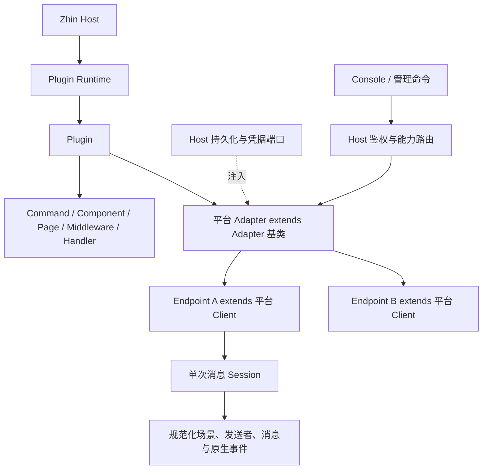

# Adapter、Endpoint 与消息 Session 重构实施方案

状态：2026-10-30 已按确认方案完成本地实现与集成验证。本文保留实施合同和本地验收证据；变更以 PR 提交审查；尚未合并、发布或进行真实平台验收。

关联：[分层架构](../concepts/architecture.md)、[Plugin 模型](../concepts/plugin-model.md)、[ADR 0045：个人 Session 模型策略](../adr/0045-personal-session-model-policy.md)。

## 1. 已确认的目标与边界

- Plugin 向 Zhin 注册所有能力；Adapter 只是其中的 IM Channel 能力。command、component、page、middleware、handler、tool 等继续正常注册。
- 放弃 Worker/thread 方案，不引入线程执行器、IPC 或 SDK RPC 代理。
- AdapterController 的通用管理逻辑收进 `Adapter` 基类；平台 Adapter 继承它，不再并列维护 Controller 管理层。
- Endpoint 继承实际平台 Client，并符合独立的 Endpoint 规范。ICQQ Endpoint 是真正的 ICQQ Client，不是原生对象的 RPC 代理。
- Adapter 负责所属 Endpoint 的创建、更新、启动、停止、销毁与登录验证。Host 只做鉴权、持久化端口装配和按 Adapter 能力委派。
- 字符串 `adapter: 'icqq'` 推断平台 Adapter、Endpoint 和事件类型；业务文件不导入 Adapter 类、不重复写泛型、不使用 `as` 强转。
- Command 同时推断平台 Session、params、options；现有命令能力和 Plugin Runtime 注册机制继续使用。
- 启动配置与可恢复的运行配置分开；运行配置调整不重启进程、不触发 Root generation 重建，不写启动 YAML 或 `.env`。
- 用户已授权提交、推送并创建审查 PR；不合并、发布、部署或执行真实平台登录。

## 2. 当前架构的具体限制

`AdapterIndex` 当前同时承担目录投影、Endpoint 构造与运行状态管理。全表重建不能满足单账号调整不影响其它账号。现有账号配置写入 `.env` 的路径还会触发 Root 配置重建，不能只改返回文案为“无需重启”。

当前框架 Endpoint 是带私有状态的基类，平台端点又组合一个 Client；它无法直接让 `extends Client` 的类实现。因此需要把 Endpoint 的规范与运行时管理实现分开。ICQQ Client 已有 `on/emit/off`，框架不能用同名方法覆盖原生事件机制。

现有 Message 有规范化场景、发送者、内容和 `$client`，但没有完整的 Adapter 类型关系；ICQQ 原生事件在独立事件流保真，却没有随同规范化 Message 一起向下传递。新 Session 必须直接绑定同一次 SDK 回调，不能靠另一事件流的“最近一次事件”关联。

## 3. 所有权与模块划分



职责分配：

- `plugin-runtime`：generation、snapshot、资源持有与退役；不加入平台账号或 AI 领域状态。
- `feature-kit`：开放的 Adapter 类型注册表、低层结构化 Session 类型与 operation 读取合同；不反向导入 adapter/core/agent。
- `adapter`：Adapter 基类、Endpoint 结构规范、所属账号目录、生命周期与操作租约。AdapterIndex 仅投影和路由。
- `core`：从真实入站实例绑定 Session，统一入站派发与发送链，保留 Plugin 作者身份及 generation。
- `command/handler/middleware`：复用该 operation 的 Session 视图，在声明处推断类型；不从 metadata 再猜账号。
- `ai/agent`：模型目录、分层策略、个人 AI Session、不可变回合模型快照；不管理平台连接。
- `basic/cli`：组合持久化、加密凭据、身份、HTTP 与 Adapter/Agent 端口；不创建全局 Endpoint 管理旁路。
- Console：消费正式合同，不拼造内部身份，不把运行配置写回启动文件。

新增类型和实现优先落在现有包内。下层包不能导入 Core/Agent 的 Session 实现；通过结构合同或开放类型注册推导，不放宽架构门禁。

## 4. Adapter 与 Endpoint 合同

以下为设计伪代码，正式实现必须保留 SDK 原生构造、事件重载和返回类型：

```ts
declare const endpointSpec: unique symbol

interface Endpoint {
  readonly [endpointSpec]: EndpointSpecification
}

abstract class Adapter<E extends Endpoint, Config, Events> {
  getEndpoint(instanceId: string): E | undefined
  list(): readonly EndpointMetadata[]

  add(configuration: Config, expectedRevision): Promise<MutationResult>
  update(instanceId, configuration: Config, expectedRevision): Promise<MutationResult>
  start(instanceId, expectedRevision): Promise<MutationResult>
  stop(instanceId, expectedRevision): Promise<MutationResult>
  remove(instanceId, expectedRevision): Promise<MutationResult>

  protected abstract createEndpoint(config: Config, context): E | Promise<E>
  // 通用状态与清理由基类持有；平台钩子实现 SDK 特殊行为。
}

class IcqqEndpoint extends Client implements Endpoint {
  readonly [endpointSpec]: EndpointSpecification
}
class IcqqAdapter extends Adapter<IcqqEndpoint, IcqqConfig, IcqqEvents> {}
```

Framework hooks 使用独立 symbol 命名空间，不接管原生 `emit/on/off`。入站经注入的事件端口进入 Zhin；原生 Client 的事件语义保持不变。`$client` 的兼容视图指向实际 Endpoint 本体，旧“client 必须是不同对象”的约束应在同一次迁移中替换，不能用 `client = this` 绕过旧检查。

新增仅保存时不能构造 Client：ICQQ 构造本身会访问 SDK 数据目录。对象构造延迟到显式 start。更新运行账号创建新 incarnation，而非修改 SDK 的只读配置。

## 5. 单次消息 Session

单次消息 Session 与可持久恢复的个人 AI Session 分开。演进现 RuntimeMessage 为唯一操作门面，不再叠加第二套可变消息上下文。

```ts
interface MessageSession<A> {
  readonly adapter: A
  readonly endpoint: EndpointOf<A>
  readonly scene: SceneOf<A>
  readonly sender: SenderOf<A>
  readonly message: MessageOf<A>
  readonly event: NativeEventOf<A>
  readonly signal: AbortSignal
  reply(content): Promise<DeliveryReceipt>
}
```

字段语义：

- adapter/endpoint：该次实际入站的实例，从可信绑定注入，不是字符串、DTO 或“最新账号”查询结果。
- scene：private/group/channel 判别联合，保留 canonical 地址、parent、thread；名称未知就缺省。
- sender：稳定身份与平台提供的称呼、角色。平台群角色与 Host master/trusted 权限分别表达，不互相授予。
- message：规范化 ID、文本、segments、引用、是否 mention；框架 receivedAt 与可选 platformSentAt 分开。合成 ID 不冒充平台原生 ID。
- event：同一个 SDK 回调的原始事件对象，保留原型、方法、Buffer 等；不 serialize/deep-clone/deep-freeze Client 或原生事件。
- 真实用户消息进入个人 AI Session 前必须具有可靠 sender.id；系统/合成入口不伪造用户身份或在线 Client。

规范字段做只读快照，原生对象只保留操作内引用。持久化、日志、Console 和 AI 上下文只接收明确的数据投影，不序列化整个 Session。

保留旧 `conversation/content/$client/$reply` 等兼容视图时，它们从同一 Session 派生，不另存状态。Command 的历史扁平快捷字段也不能成为另一份真相。

## 6. 字符串注册与 Command 推断

将现有 AdapterClientRegistry 演进为以 Adapter 类型为来源的一处开放注册，不能额外并存一份手工 Endpoint/Event 注册表：

```ts
// 平台包声明；业务命令无需导入该类。
declare module '@zhin.js/feature-kit' {
  interface AdapterRegistry {
    icqq: IcqqAdapter
  }
}
```

低层通过结构化类型合同提取 Adapter 的 endpoint 与 event 类型，不反向 import 平台类。项目统一声明入口加载已安装适配器声明，业务文件不加适配器运行时导入；不能声称仅安装 npm 包就会使 TypeScript 自动扫描所有声明。

```ts
export default defineCommand({
  adapter: 'icqq',
  params: {
    groupId: { type: 'integer' },
    text: { type: 'text' },
  },
  options: { silent: { type: 'boolean', default: false } },
  async execute({ session, params, options }) {
    if (!session) return // 直接调用命令时可能没有 IM 来源
    session.adapter   // IcqqAdapter
    session.endpoint  // IcqqEndpoint
    params.groupId    // number
    params.text       // string
    options.silent    // boolean
    await session.reply(params.text)
  },
})
```

Command 定义沿现有映射联合，以 `adapter` 字面量选择 execute 上下文；params/options 各自 const 推断。返回类型、withConfig、注册函数和命令工厂也必须保留推断。不能只在回调内生效，随后擦除为 string/unknown/any。

未声明 adapter 的命令只取得公共类型，平台操作需要显式类型收窄。声明 icqq 不代表一定是群消息；场景需独立收窄。permit 字符串不伪造类型保证。

IM 分派先检查实际平台再 execute。无真实消息的直接命令调用不能获得非空平台 Session：保留现有直接调用能力，使用诚实的可选 Session/入口区分，不能只为静态类型加入未经确认的全局拒绝规则。

类型回归必须验证正确推断与错误拒绝：错误平台方法、错误参数类型、未收窄群字段、withConfig、工厂包装、无适配器导入的项目声明入口、子类特有方法。

## 7. 状态、持久化与运行恢复

分离启动声明、持久 desired、内存 actual、临时 login challenge、operation lease 和派生 UI 视图。不得把派生 effective 配置写回作为第二权威。

- 启动声明：Plugin 与能力、部署模型连接/模型/预设、初始策略、工具权限、身份绑定与网络边界。
- 持久 desired：账号配置与 desiredEnabled、各层允许的模型引用覆盖、个人模型与个人 AI Session 选择。
- actual：SDK 对象、连接、在途任务；归所属 Adapter 的具体 Endpoint incarnation。
- login challenge：精确绑定账号 incarnation，内存管理；进程重启重新握手，不重放旧验证码/挑战。

复用 PersistentStatePort 的读取与一次 CAS。明确不存在、读取失败、冲突和提交未知分别处理。无持久化能力时不能把内存状态伪称可恢复；既有静态 Host 路径保持可用，动态管理明确不可用。

账号私有配置/凭据加密持久化，主密钥由 Host 私有保存。优先让密文与 revision 处于一次原子提交，避免对 `.env` 的跨文件修改或产生另一套明文配置。持久化实现不能从 Endpoint 反向依赖 CLI/Agent。

CAS 冲突不自动覆盖；提交未知不自动重试、不删除可能被引用的数据。保存 desired 成功与 actual 接入失败分别报告。对未知平台发送结果不自动重放。

## 8. 已确认的账号行为

- add：仅保存配置，不创建 SDK 对象、不自动启动登录。
- start：持久化启用意图，创建并启动目标实例。
- stop/remove：停止目标接入、取消其在途操作并关闭；其他账号继续运行。
- update：已启动账号保存后仅重连该账号；未启动账号更新不自动启动。
- remove：删除账号配置，保留历史与 SDK 数据；新建同名账号分配新逻辑身份，旧 Session/个人设置不继承。
- restart：恢复 desiredEnabled；停用账号不能复活。稳定逻辑身份不随 reconnect/generation 改变，对象重建仅改变 incarnation。

Root generation lease 与 Endpoint incarnation lease 同时约束框架操作。reply 固定到实际实例，不再通过同名目录查新实例。暴露真实 Client 后，框架不能撤销已提交的平台副作用，也不能透明取消插件直接调用的全部原生 SDK 方法；不能据此宣称权限沙箱或全量可取消。

统一消息链保持 `Message.$reply / Adapter.sendMessage -> renderSendMessage -> before.sendMessage -> 平台 Endpoint`。原生 SDK 可访问性不替代框架发送入口。

## 9. 动态模型与配置形态

部署 modelCatalog 采用字典键补 id、Host 补 ownerId 的简写；显式冲突报错，完整旧形式兼容。revision 仍沿已确认的显式合同，不新增隐含轮换策略。

```yaml
ai:
  modelCatalog:
    connections:
      main:
        revision: 1
        sdk: openai-compatible
        baseUrl: https://api.example.com/v1
        secretRef: env://AI_API_KEY
    models:
      fast:
        connectionId: main
        model: your-model
        capabilities: {}
    presets:
      daily:
        modelId: fast
  modelPolicy:
    defaults:
      chat: daily
  agents:
    zhin:
      nickname: Zhin
```

运行时只覆盖允许的预设引用：default 可 chat/perception/summary；Adapter、Endpoint 可 chat/perception；Scene 可 chat；个人 Session 可 chat 或恢复继承。先同层覆盖静态基线，再按 Session > Scene > Endpoint > Adapter > default 解析。

summary 仅部署级：runtime 显式 summary 优先，否则保留静态显式 summary；均未配置则跟随有效部署 default chat，不跟随个人/场景 chat。需保留 summary 继承来源，不能从已烘焙值猜。

每轮只读一次运行策略，解析完整 chat/perception/summary 并租用资源；旧轮不追读最新设置。IM、ambient、场景唤醒、默认 standalone/default completion、管理摘要都走同一解析入口，显式调用选择保持固定。

聊天所有配置均固定选定模型，保留同模型重试；已明确配置的识图备用链继续保留。模型选择不扩权。

## 10. Console 与现有能力接入

- 模型页：部署目录与初始聊天模型，使用同一 AI 草稿/CAS。首次迁移不能同时保留冲突的 provider/model 与 preset；仅转换用户编辑的角色，保留其权限/MCP/名称。
- 运行时策略：独立读取/保存持久覆盖，不回写启动配置；删除字段恢复继承，显示来源与操作错误。
- 个人模型与会话：个人连接、密钥、会话模型选择，沿原完整 owner 绑定。
- Adapter 能力页：所属账号的增删改、启停和登录验证；Host 鉴权后委派所属 Adapter。
- 全局 Endpoint 页只观察和导航，不能绕过 Adapter 所有权。

作用域选择使用真实目录，不能要求用户填写 Host 哈希或拼 canonical 地址。API 只返回公开 metadata，不返回 config 凭据、secretRef 或私有执行参数。Host/身份切换后旧草稿和迟到响应不能落到新连接。

## 11. 迁移、待确认项与回滚

旧目录/Controller 草稿只作输入，正式实现替换为 Adapter 基类一处权威。旧 Client 组合模式、原生事件桥接、命令 Session 投影、Index 运行状态必须一起收拢，不能长期维持两套可写状态。

旧账号首次导入时保持既有 canonical identity、历史与 SDK 目录。删除后重建才分配新身份。已初始化的空 snapshot 不是缺省，防止旧启动账号复活。不得在 prepare/HMR 时静默写入 legacy seeds。

已确认的迁移行为：首次修改前展示旧账号清单，由管理员确认一次迁移；确认后以一次 CAS 保留原 canonical identity 与历史，并加密保存当前账号状态。此后账号调整以数据库为权威，启动文件和 `.env` 不改动。未经确认不静默导入。

已确认的身份变更行为：真实平台账号身份变化按替换账号处理，以一次 CAS 移除旧 desired 并保存新身份；取消/关闭旧实例，保留旧历史，不继承旧 Session 与个人设置。新身份沿新增规则先保存停用，手动启动。平台声明身份字段及可修改连接字段；不能按字段名猜测所有平台 Token 的身份语义。普通连接参数更新仍只重连原账号。

登录任务携带 canonicalId、instanceId、epoch、不可复用的 incarnationId 和独立随机任务 ID；在原 incarnation 取消时立即失效。验证码提交后到 SDK 调用前仍检查原信号，避免已经 resolve 的任务在退休后继续执行。

回滚保留启动配置、持久状态 revision、主密钥、密文和历史；不因回滚代码删除用户状态或重新分配旧历史。平台登录和发送不能与数据库做原子回滚，必须保留 desired/actual/unknown 的含义。 回退到不认识运行时账号数据库的旧版本前，必须停服并核对启动配置中的账号清单与停用状态；旧版本不会自动读取该数据库，不能直接启动并假定运行时停用状态仍有效。此实现不提供自动降级迁移，也不自动修改启动文件。

## 12. 分工与实施顺序

- Root：本文与 ADR 同步、模块合同衔接、Core 消息 Session 接入、Host 账号持久化与既有入口接线、完整 diff 审查及端到端验收。
- Adapter Agent：Adapter 基类/Endpoint 结构规范、AdapterIndex 投影、ICQQ 继承 Client 与平台钩子、生命周期/多态回归；移除 Worker/独立 Controller 草稿。
- Session/类型 Agent：feature-kit 类型注册与结构 Session、Command/Handler 的字符串推断、参数与配置推断、真实运行入口与类型回归。不得反向引入 Core/Adapter。
- 模型/Console Agent：完成既有动态策略未接通入口与恢复验证，再接 Console；不改变 Adapter/Core 所有权，不增加角色 CRUD。

有依赖的共享类型先形成明确合同再接入，各 Agent 仅修改分配文件；跨目录修改先协调，禁止覆盖并发编辑。阶段顺序：

1. 文档与合同、草稿盘点。
2. Adapter/Endpoint 与字符串类型推断基础；补两种不同平台形态的测试证明多态。
3. ICQQ 与 Core 实际入站/Command/发送链；统一 message/native/client 数据来源。
4. 持久账号管理与独立启停、动态模型各入口、Console。
5. 迁移/回滚、完整验收、公开文档与变更说明。

## 13. 验收清单

- [x] Plugin 其他能力照常注册，Adapter 仅管理自身 Endpoint。
- [x] ICQQ Endpoint 是实际 Client 子类，原生事件重载与 disposer 语义未改变。
- [x] 无业务 Adapter 类导入的 Command 推断 Adapter、Endpoint、params、options；withConfig/工厂不退化。
- [x] Session/event 同源且不复制 SDK 对象；群/私聊/频道、临时私聊、parent/thread 正确。
- [x] 同名账号更新/删除重建不会让旧 Session 操作新实例。
- [x] 新增不构造 Client；启停/更新只影响目标账号，其他账号与在途工作不重建。
- [x] 运行调整前后真实 Host PID、Root generation、启动文件与 .env 不变。
- [x] 真实 SQLite 重开/进程重启恢复期望状态、模型选择；停用/删除不复活。
- [x] 登录挑战只属于当前 incarnation；过期、取消、关闭、重启路径不会错投或重放。
- [x] CAS 冲突、提交未知、存储故障、启动失败、关闭失败与发送未知有正确含义，无写重试。
- [x] 各模型入口、摘要继承、owner 隔离和权限保持一致；无密钥进入公开 DTO/历史/日志。
- [x] 架构、类型、lint、相关单测、Agent eval 与完整仓库门禁通过；本地/CI/真实平台证据分别报告。

勾选表示以下本地验证通过，不表示 CI、发布或真实平台验证完成。全部聊天模型固定、runtime/static 边界和首次迁移/替换行为按已确认规则执行；没有新增自动重试或生产迁移。

## 14. 本地验收与交付状态

- 冻结后构建：45 个 workspace 构建任务通过；ICQQ 与 Command 独立类型合同通过，覆盖字符串注册、params/options、withConfig、工厂与预期错误。
- 全仓门禁：`HARNESS_SEQUENTIAL=1 pnpm check:all`，59 项全部通过，包括全量单测、架构/边界、类型、lint、Stable Smoke、L4-CI 与安装体积。
- Agent 评测：冻结源码上的 `pnpm eval:agent`，10 个测试文件、195 项用例全部通过。
- 实际构建后的 CLI：[账号验收](../../basic/cli/tests/plugin-runtime/runtime-endpoints/live-host.test.ts)与[模型验收](../../basic/cli/tests/plugin-runtime/runtime-model-policy/live-host.test.ts)通过。本地子进程、HTTP、SQLite 为真实实现，平台 Client 与模型服务为合成实现。验证 PID/generation/启动文件不变、重启恢复、停用不复活及无原子持久化 Host 的静态兼容路径。
- 原失败边界的回归：[消息 Session](../../packages/im/core/tests/operation-session-runtime.test.ts)、[系统/请求事件](../../packages/im/core/tests/canonical-event-endpoint.test.ts)、账号 CAS 与登录隔离均已覆盖原红到修后绿；后台审核持有独立账号租约。
- Console：独立 Console 分支 571 项测试及构建/类型检查通过；共享 Adapter SDK 69 项测试通过，另做双本地模拟 Host 的浏览器交互与桌面/移动端检查。此证据不是已部署页面验收。
- 默认并行门禁曾出现旧 Client 夹具失败（已修复，业务断言保留），及本机 `git-ai` 写 `refs/notes/ai` 与临时 Git 目录删除竞争。保留原 CI 断言与全局工具配置，最终使用仓库支持的串行模式通过同样 59 项门禁。

本次没有真实 QQ 登录、外部模型请求、用户账号数据库迁移或生产配置更改。实际 SDK 对取消信号的行为、各平台登录与 PostgreSQL/MySQL 持久化仍需对应环境验收；直接保留 SDK 引用的自定义代码不由框架租约强制代理。源码以 PR 交付审查，既有 workspace 配置与补丁保留。
