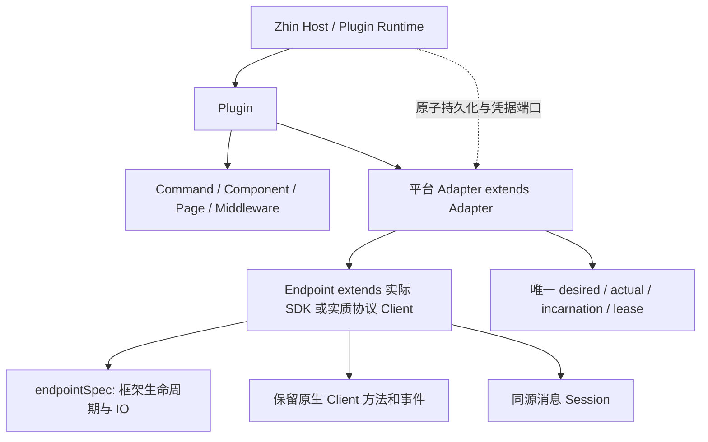

# Adapter 全量目标模式迁移

状态：完整目标实现与本地验收已完成，准备 PR 审查。不保留 Adapter 旧创作接口或运行时兼容分支。框架见 Zhin #1104，配套 Console 见 #48；远端验证以对应 PR 的当前 checks 为准。

## 范围和验收单位

覆盖仓库全部 22 个适配器，以及共享合同、Host、Console、示例、脚手架、测试工具、文档和门禁。Plugin 仍正常注册全部能力；Adapter 只管理自己的 Endpoint。保留已确认的旧账号显式数据迁移、历史保留和新身份隔离，这不等于保留旧代码接口。

每个平台必须通过真实约定入口 → AdapterIndex → 原生/实质协议 Client Endpoint → Core Session 的验证。只改工厂名称、继承一个空壳类或给旧接口换名称均不算完成。

## 目标合同



```ts
interface Endpoint { readonly [endpointSpec]: EndpointSpecification }
class PlatformAdapter extends Adapter<PlatformEndpoint, Config, NativeEvents> {
  protected createEndpoint(config, execution) { return new PlatformEndpoint(config, execution) }
}
class PlatformEndpoint extends ActualClient implements Endpoint {
  readonly [endpointSpec] = createEndpointSpecification(this, {
    start: signal => this.#startFramework(signal),
    open: () => this.#openFramework(),
    close: () => this.#closeFramework(),
    stop: () => this.#stopFramework(),
    send: request => this.#sendFramework(request),
  })
}
export default defineAdapter<Config>({ capabilities, createAdapter: context => new PlatformAdapter(context) })
```

- `defineAdapter.createAdapter` 为唯一必填工厂；删除 `create`、`LegacyAdapter`、`ManagedEndpoint`、`EndpointImplementation` 和公开旧 Endpoint/ClientEndpoint 基类。
- Endpoint 是结构规范；代级事件接纳与 Peer 投影属于包内 EndpointRuntime，不能让平台继承它。
- 保留 `endpointSpec` 和 `createEndpointSpecification`。需要规范地址、locale、可靠事件接纳时，通过该命名空间访问；不得占用 SDK 的 `start/stop/send/on/off/emit/config` 名称。
- 唯一 `AdapterRegistry` 注册实际 Adapter 类；删除 `AdapterClientRegistry`、旧 Client 描述符与双注册。Command/Handler/Middleware 从同一注册推导 Endpoint 和 Events。
- SDK 有可公开继承的真实 Client 时直接继承。无 SDK 或确属复合协议时，将真实请求、传输、取消和协议状态移入 Client，再由 Endpoint 继承；禁止 Client 回调 Endpoint 的循环代理或为了形式造空壳。
- 不新增供应商 SDK、默认重试、通知、定时任务、权限回退或额外安全开关。保留现有协议模式、代理/TLS、ACK、重连、发送未知结果、限额和审批行为。

## 单一状态归属

| 状态 | 唯一归属 |
| --- | --- |
| 账号配置、开关、身份、revision | Adapter desired + Host 加密 CAS |
| 实际 Client、资源和 incarnation | 所属 Adapter 的实际执行 |
| socket/pending action/SDK cache | 实际 Client；复用现有 EndpointLifecycle |
| 登录挑战 | 绑定实际 incarnation 的 LoginAssist 或平台真实流程 |
| 账号列表/运行状态 | 从 Adapter 投影，不再另写 runtimeState.endpoints Map |
| 单次消息 | 同一个 Client 回调的 Session，只读规范视图 |

新增账号不实例化 Client、不登录。停止/删除取消目标在途任务再关闭；更新运行连接只关闭并重建目标，关闭失败不能并行启动同账号的新 SDK。稳定逻辑身份与不可复用 incarnation 分开。SDK 结果未知不重放。

移除目录 Map 时保留确有领域意义的扫码绑定中间状态、人工草稿与历史，不以“清理兼容”为由删除用户数据。

## 已确认的补充决策

1. 不透明凭据变更：修改已有账号时，使用现有只读身份接口核验。同一真实平台 ID 保留内部身份并重连；不同 ID 走替换流程，新身份先停用；核验失败不保存。无法核验的平台要求显式替换。新增账号仍只保存。不修改正在运行 Client 的凭据来完成探测，不在验证阶段写 SDK 凭据文件。
2. 企业微信增加必填 `agentId`，同步类型、配置 schema、表单、向导和文档；缺失时报错。禁止把 agentSecret 当 agentid。
3. Satori 每个 Endpoint 明确选择 `platform` 和 `userId`；禁止首个 login 控制所有发送，也禁止其他 login 的消息混入当前账号。
4. OneBot12 同样必填 `platform` 和 `userId`。入站只接收匹配的 `self`，每次 action 在协议顶层携带所选 `self`；不修改上游 SDK，不从首个登录或 Endpoint 名称猜账号。旧启动配置需明确补齐选择后再启动；运行时更换所选账号使用显式替换。
5. 凭据更新在 desired-state CAS 前完成只读身份核验，复用已有 update/replace。Adapter 销毁取消核验；核验期间发生其他账号状态变更则旧 revision 无法提交。
6. `AdapterIndex.connection` 只投影账号身份与在线状态等只读信息，管理操作使用捕获账号 incarnation 的 `management` 端口。前台操作和后台场景刷新分别沿用各自已有的取消生命周期。

## 各平台分工

| 组 | 平台 | 目标 Client / 必保留差异 |
| --- | --- | --- |
| SDK | icqq | 实际 ICQQ Client；移除重复目录，保留登录挑战与 heartbeat |
| SDK | qq | Bot WEBSOCKET / MIDDLEWARE 两种真实 Client；HTTP 继续由 Host 挂路由 |
| SDK | telegram | 实质 Telegram API Client；polling/webhook、offset、去重 |
| SDK | discord | Gateway Client / REST Client 分开；不在 HTTP 模式构造 Gateway |
| SDK | slack | WebClient + 仅 Socket 模式持有 SocketModeClient；保留 ACK |
| SDK | kook | 既有 RuntimeKookClient；不重复进程 listener/connect/reconnect |
| HTTP/auth | dingtalk | 实质 HTTP Client + 原 Stream；保留可靠接纳后 ACK |
| HTTP/auth | lark | 实际官方 Client + WSClient；保留 httpInstance、代理/TLS与原鉴权 |
| HTTP/auth | line | 现有实质 LINE Client；签名、reply/push 与去重 |
| HTTP/auth | wecom | 实质 HTTP Client + corpId/agentId；完整原 XML 数据 |
| HTTP/auth | wechat-mp | 现有协议 Client；签名/AES、完整原消息 |
| HTTP/auth | weixin-ilink | 现有 Client；QR、token/cursor/context 按账号身份隔离 |
| HTTP/auth | email | 实际 IMAP + SMTP 复合能力；保留双向配置与 ParsedMail 原对象 |
| HTTP/auth | github | 既有 GhClient（gh + fetch/JWT）；不引入 Octokit |
| 协议/本地 | napcat | 既有实质 Client；正反向 WS/HTTP、echo pending |
| 协议/本地 | onebot11 | 实际 imhelper Client，manual receiver；self 身份探测 |
| 协议/本地 | onebot12 | 实际 imhelper Client；self/platform、guild/thread、api_url |
| 协议/本地 | milky | 实际 imhelper Client；WS/SSE/webhook + HTTP action |
| 协议/本地 | satori | 实际 imhelper Client；按 platform/userId 精确选择和隔离 |
| 协议/本地 | sandbox | 既有实质 Client；多浏览器连接与原生 send 方法 |
| 协议/本地 | bilibili | 既有 Web API Client；QR、人工草稿、历史和凭据归属 |
| 协议/本地 | bilibili-live | 既有 Client；房间解析、刷新 token、二进制帧与匿名系统场景 |

Root 负责共享合同、身份核验协调、Host/Console、示例/工具、全仓删除检查和集成验收。三组 Agent 各自负责表内平台的实现、注册、schema/文档及测试；不并改共享合同。

## 必须删除的过渡路径

- 工厂 `create` 与运行时自动 materialize/fallback。
- 可继承的旧 Endpoint 和 ClientEndpoint 公开出口。
- 旧 ClientRegistry 描述符推断分支与平台重复类型表。
- 各平台作为运行账号目录的 endpoints Map，以及写文件/.env后重启的账号管理路径。
- 已移除合同的示例、脚手架和测试夹具；不得继续发布旧写法。

正常缺失值、未启动、能力不支持和操作未知仍须真实表达；删除兼容不等于删除独立保护。未获授权的原平台行为调整只记录，不顺手改变策略。

## 验收与推进

1. 共享目标合同落地，三个平台组并行实施；所有调用方一起迁移，不保留双路径过渡提交为最终结果。
2. 各平台验证实际 Client 类型/事件重载、SDK 原方法、消息 event 引用、场景/发送者/消息、构造副作用和资源所有权。
3. 通过真实 Index/Core 入口验证 pending 入站、就绪后发送、停止/更新/替换、旧回调/登录挑战、取消/drain/异常释放及另一账号继续工作。
4. 验证账号动态配置、身份核验、加密 CAS、重启恢复；确认 PID/generation/启动文件不变。
5. Repo 中旧创作符号与旧工厂全部清除，公开文档和生成物同步，更新有依据的 API 快照；不放宽门禁。
6. 运行各组必要回归、全仓 check:all、Agent eval、独立平台类型测试、运行时5MiB与IM核心10MiB预算、Console测试/类型/构建。
7. 完整 diff 自审与独立交叉复查后才把 PR 恢复待审。公开 CI、模拟/本地和真实平台证据分开；没有真实账号授权就不进行供应商调用。

本地验收记录（2026-10-30）：全部 22 平台完成目标迁移；104 个构建任务、完整 59 项 harness、196 个 Agent eval 以及 Console 的 615 项测试、类型与构建通过。平台覆盖实际安装 SDK 与真实 Index/Core/HTTP/WS 入口，外部 IO 使用合成或本机边界；这不构成真实账号登录或生产验证。

生成插件另经 tarball 外部消费者验证：只加载插件的公开类型入口即可按 adapter 字符串推断原生 Endpoint；正负类型断言、完整声明检查与公开类／约定工厂的运行时实例身份一致。SDK 不提供强制取消的解析或 ACK，仅取消逻辑等待并拒绝迟到结果，不宣称已物理终止供应商操作。
