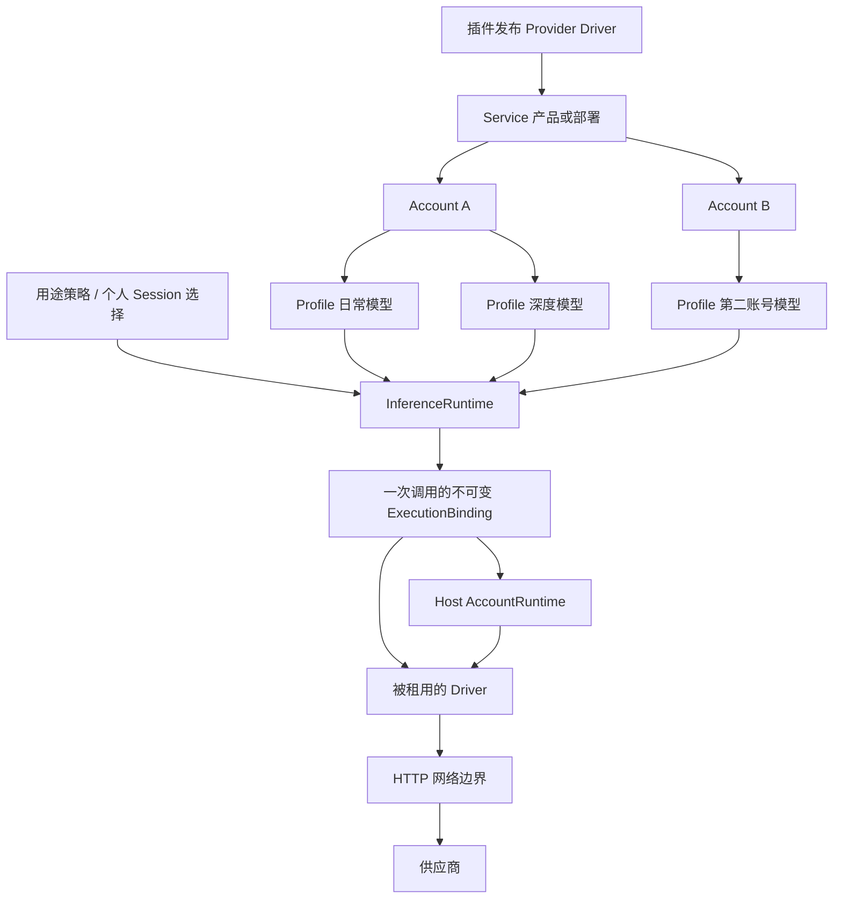

# AI Provider 目标架构：服务、账号、模型配置与用途

> 已批准设计基准的仓库内副本。原始设计快照保持不变；实施状态、回归证据及未完成范围见 `ai-provider-runtime-implementation.md`。本文件不代表已通过发布或实号验收。
>
> 原始快照 SHA-256：`3277fd1b8b1641e5ab555d70d632f2241e85ea049570e8d8a164b62b0c141069`。

状态：设计基准已确认，实施中。2026-11-03。本文包含实施期间已单独确认的补充；原始快照保持不变。

本稿替代上一版“扩展既有 modelCatalog”的设计约束；上一版审查结论不自动适用于本稿。允许破坏配置和插件接口，目标是职责、使用体验与长期维护合理。现有代码用于确认必须迁移的行为和数据，不用于限定新接口。

## 1. 需求与必须保留的结果

- 优先研究 Claude、Codex、OpenCode、Antigravity；API Key 与 OAuth 都是认证方式，不冒充模型能力或 SDK 类型。
- 语言模型和真正的结构化决策模型都能配置多份，在用途或受信调用时选择；Choice/Score/Noul 保留其真实统计合同。
- 同一服务支持多账号，同一账号支持多模型/参数组合，不复制认证配置、不自动切换账号。
- 启动装配与运行时可变项分开；可变配置持久化、重启恢复、调整时不重启整个进程。
- 个人选择只影响已允许的用途；凭据归属、模型使用权、工具权限及审批分开。
- 所有请求路径，包括辅助调用、子任务、定时任务、工具续轮与恢复，都使用相同的身份和选型机制。
- 方案先多 Agent 比较与审查，再由用户确认；当前不写业务代码，不登录、不读取凭据、不发模型请求。

静态证据基线为 Zhin main `78519074d126c04794ced10424901a2d05b2a684`、9router `1fe586bb1cf35e1ed0cb2150a8ef7d1db040b21d`。服务协议和官方使用边界沿用独立上游研究，不把客户端登录能力解释为任意第三方接入授权。

## 2. 三种独立方案与选择理由

**A：最少用户概念。** 一份 Provider 对应一个账号连接，命名模型合并原 Model/Preset，用途直接选模型。常见配置短，list/generate/decide 容易理解；但服务端点、登录主体和协议定义仍挤在一个 Provider 概念里，同一产品多账号容易重复管理服务资料。采用它“模型和预设合并”的简化，不采用其账号与服务合一。

**B：按数据所有权分离。** Driver 是代码；Service 是产品/部署；Account 是访问身份；Profile 是账号＋模型＋参数；用途仅选择 Profile。模型只是服务目录中的值，不再建一张顶层模型资源表。多账号和认证轮换的归属清楚，运行时数据库可成为唯一配置权威；代价是管理模型比 A 多一个服务对象。采用它作为目标领域结构。

**C：插件扩展优先。** Driver 通过正式能力注册，声明认证、模型和执行合同；SDK 留在实现内部，核心不增加品牌枚举或 instanceof 判断。普通插件通过作用域绑定的推理接口使用模型。扩展性好；若把所有数据与执行都泛化为万能 registry，会增加理解成本。采用其单一注册入口与类型合同，不建设通用工作流框架。

综合结果：**B 的领域结构＋A 的配置简化＋C 的开放 Driver 合同**。评价依据是职责、正确使用的难度、复杂性集中程度和性能/生命周期，而非兼容旧格式或少改几行代码。

## 3. 领域模型

| 概念 | 定义 | 保存什么 | 不负责什么 |
| --- | --- | --- | --- |
| Provider Driver | 插件提供的某个产品/协议实现 | 配置 schema、认证方法、模型能力和执行工厂 | 当前账号、Session、用途选择、工具审批 |
| Service | 一项实际服务部署/产品 | driver 引用、经验证的目标配置、模型目录元数据 | token、用户登录状态 |
| Account | owner 在某 Service 上的访问身份，可为无认证的本地服务 | 不可复用身份、认证方式、凭据引用、认证状态 | 模型参数、任务选型 |
| Model Profile | 供用户选择的一份模型配置 | account、服务原生 model ID、受支持参数 | 重复保存密钥、重复定义用途策略 |
| Purpose Policy | 聊天/摘要/识图/决策用途的选型与既有工作策略 | Profile 引用、用途 mode/阈值等 | 协议、token 刷新、任意配置覆盖 |

ModelDefinition 是 Service 目录中的值：标识、支持的调用合同、协议、能力与来源。不要求用户另建 Model 与空 Preset 两张表。一个原生模型可以有多份 Profile，分别使用不同账号/参数。

SDK 名称、协议路由、租约 revision、token revision 都不是普通用户模型配置项。自建兼容服务需要的协议/模型目录由 Service 的 Driver schema 统一表达一次。



## 4. 配置权威：运行时一份，启动文件不再叠加模型目录

### 4.1 启动配置

`zhin.config.yml` 负责插件/Driver 加载、Host 存储和私有目录、身份绑定、安全与网络边界，以及 Agent 的其他启动装配。**Service、Account、Profile、用途选择不再同时拥有“启动基线＋运行时覆盖”两个来源。**

这些可变项由 Host 持久化管理。Console、CLI、声明导入都调用同一管理 Interface，提交同一份版本化配置图。新调用读取已提交快照，正在执行的调用固定既有绑定。保存可变项不改启动文件、不重启进程，重启也不重新 seed 被删除的账号。

选定的 Host 存储方案为：配置图、mutation 回执和私有加密凭据记录使用同一具备事务能力的持久仓储，主密钥仍仅存 Host 私有本地文件。凭据内容与身份绑定加密，公开 snapshot/配置导出/Console DTO 只含引用与状态；登录和 Key 保存不需要再协调“新凭据文件已写、图还没提交”两个存储权威。token 更新走独立私有记录版本，不改整张配置图。

这是目标仓储合同，不声称现有抽象已经提供所需多记录事务；实现需按实际数据库后端验证。AI domain 只依赖窄仓储 Interface，不依赖具体 SQL/IM。纯 IM 安装不加载这组可选 AI 模块和 Driver；不为此次重构扩张默认安装分档。

启动没有模型时可以进入管理面；推理明确显示未配置，不能自动选择可见列表的第一项。管理 API 仍要求既有认证，不因首次配置开放匿名访问。Driver 未安装/不支持合同等错误是明确诊断状态，不能变成假 Provider。

### 4.2 声明文件只是显式导入/导出

提议使用 `ai.plan.yml` 作为可审查的非秘密声明格式，提供“预览差异→明确应用→导出”管理操作。它不是自动 watch 的第二个配置源；自动同步、GitOps reconciler 或启动 seed 不在本轮。

下面是目标格式示例，不是当前版本支持语法，也不是实号支持声明：

```yaml
version: 1

services:
  codex:
    driver: codex-subscription
  opencode:
    driver: opencode-go
  judgments:
    driver: typesafe

accounts:
  codex-main:
    service: codex
    auth: { method: oauth }
  codex-second:
    service: codex
    auth: { method: oauth }
  opencode-main:
    service: opencode
    auth: { method: api-key, source: env://OPENCODE_GO_API_KEY }
  judgment-main:
    service: judgments
    auth: { method: api-key, source: env://TYPESAFE_API_KEY }

profiles:
  daily:
    account: codex-main
    model: '<实际可用的 Codex 模型 A>'
  deep:
    account: codex-main
    model: '<实际可用的 Codex 模型 B>'
  alternate-account:
    account: codex-second
    model: '<实际可用的 Codex 模型 A>'
  go-chat:
    account: opencode-main
    model: '<实际可用的 OpenCode 模型>'
  quick-judgment:
    account: judgment-main
    model: '<经确认的决策模型 A>'
  reviewed-judgment:
    account: judgment-main
    model: '<经校准的决策模型 B>'

purposes:
  chat: { profile: daily }
  decisions:
    skills: { profile: quick-judgment, mode: shadow }
    tools: { profile: quick-judgment, mode: shadow }
    memory: { profile: quick-judgment, mode: off }
    agents: { profile: quick-judgment, mode: off }
    approval: { profile: reviewed-judgment, mode: off }
    ambient: { profile: quick-judgment, mode: off }
```

示例 mode 只用于说明格式，迁移逐项保留原值，不自动开启 shadow/active。summary 未显式配置时保留已确认的“部署默认聊天模型做摘要”行为，个人切换 chat 不改变它。

图中键是导入文档的可读引用，不直接替代数据库身份。导入计划先解析到不可回收的内部 ID/当前版本；创建、更新、删除/重建明确区分。删除账号后同名新建不能让旧 Profile 或 Session 自动继承新账号。

导入不是全量覆盖删除：未出现的资源不自动删除，移除必须在计划的 remove 清单显式列出。reviewed plan 包含输入指纹、目标图版本、资源映射与影响；应用期间有新保存则报冲突，不能覆盖新状态。相同已应用计划重复提交只返回已完成，不再创建身份或触发登录。

环境变量只保存引用；Console 录入密钥进入加密凭据库。OAuth 声明创建待登录账号，不自动登录。导出不包含 Key、token 或其他 Host 可用的凭据包；跨 Host 导入需明确绑定本地账号或创建待登录身份，不能按名称自动继承凭据/权限。

### 4.3 运行时事务与引用

Service/Account/Profile/用途是一个有版本的配置图，更新必须验证完整引用与能力合同后提交；查询失败不等于空图。数据存储不受理时保留旧有效状态，不把尚未持久化的选型报告为已保存。

credential version、账号 incarnation、配置图 revision、Driver contract version 分开。日常 token 刷新不修改配置图；换真实账号要求明确替换并确认受影响 Profile。实际删除有引用的账号/Profile 时，计划列出影响并要求显式重绑/移除引用，不能悄悄选其他模型。

普通 Console 保存与导入应用使用同一 mutation 合同：客户端为一次确定变更提供 mutationId，仓储将配置更新与该 mutation 的内容指纹/提交结果同事务记录。相同 ID/内容重复提交返回原结果，相同 ID/不同内容报冲突；当前图版本变化时重新预览，不能用旧计划覆盖。

结果明确区分 committed、not-committed、conflict 与 commit-unknown。提交可能成功但应答丢失时，UI 显示“保存结果待核实”，按 mutationId 回查；查询失败仍为未知，不能当未保存、回写旧值或用新 ID 重放。未核实变更的后续新调用先读权威已提交快照；读失败时报告配置不可用，不凭缓存推断未提交。已经开始的执行保留原绑定。提交回执属于配置仓储的事务事实，不是控制推理业务的遥测日志；本方案不新增后台无限重试或自动清理期限。

### 4.4 Service、Account、Profile 的管理和使用归属

三种资源都带独立 root/owner 与不可复用内部身份，不从所引用 Account 自动继承管理权或公开可见性。Host 管理员可管理 Host 资源；个人只能管理自己获授权创建的资源。消费某个 Host Profile 不授予编辑 Host Service、换凭据、任意模型查询或修改 Host Profile 的权限。

Host Profile 按已有明确的模型使用政策发布；个人 Profile 保持个人作用域。首轮个人自定义 Profile 使用本人管理的 Account；若另行授权个人基于 Host Account 创建 Profile，也必须保持 Profile 本身私有、受原账号允许范围约束，不能因账号是 Host-owned 就自动公开或扩大模型可选范围。这个扩展不默认纳入本轮。

Service 的模型目录/协议/目标修改由 Service 管理者完成，Profile 参数修改由 Profile 管理者完成；参数不能修改 Service 目标或认证方法。Service 删除与账号/Profile 删除一样进入完整影响图，存在未处理引用则不能提交。修改认证/推理目标不把旧 Account 凭据发给新地址；需要明确的重新绑定/授权计划。

具体选择为：名称、显示信息和兼容合同内的目录元数据可原位更新；driver identity、认证 issuer、推理目标来源或 Go/Zen 等产品/计费边界变化创建新的 Service 身份，再显式建立账号授权并迁移选中的 Profile。旧 Service 在完成引用处理前保留，不将目标变更视为普通改 URL。Service 所有者也不能凭此直接修改其他 owner 的 Account/Profile；不具备其重绑权限时，该引用不能由本次计划自动处理。

网络边界按实际 Account owner 与有效目标检查。个人 Account 引用共享 Service 元数据，不会获得 Host 内网访问能力；个人经明确发布的 Host Profile 消费 Host Account，则沿已批准的 Host 用途规则执行。metadata 可读、profile 可用和凭据可管理分别验证，不建设新的万能 ACL 系统。

新 Service 目标地址不自动获得旧凭据。内置 OAuth 产品限定 Driver 已验证的认证/推理目标；自定义服务使用对应 Driver 和 owner 的网络规则，不提供可修改 URL 来转交订阅 token 的通用开关。

## 5. 请求路径与执行 Interface

普通调用者不管理底层客户端、密钥、refresh 或 acquire/release。推理入口使用当前 operation 绑定的 Interface；Host/框架从真实入口构造上下文，不从用户正文接受 owner/principal。

目标伪代码：

```ts
interface InferenceRuntime {
  withInvocation<P extends InferencePurpose, R>(
    intent: InvocationIntent<P>,
    use: (execution: ExecutionFor<P>) => Promise<R>,
  ): Promise<R>;
}

// 只展示框架内部的执行接缝；context由真实Turn构造。
await inference.withInvocation(
  { purpose: 'chat', context: turn.inferenceContext, signal: turn.signal },
  execution => consumeEntireTurn(execution, turn),
);
```

一次 ExecutionBinding 固定配置图、Profile/Account 身份、模型合同、Driver generation 与可信调用上下文。热更、工具续轮、候选分批或重试不重新解析“最新账号”。

withInvocation 的回调必须覆盖完整消费生命周期。裸 LanguageModel、延迟 Promise/AsyncIterable 或活动执行句柄不得逃逸回调后继续使用。框架内部消费者全量 await；普通插件公开的流式 Run 对象必须自身持有租约，直到完成/错误/取消/提前结束消费时释放，不能把回调返回当作流已完成。最终接口的可执行类型/生命周期回归是实施门禁，不宣称泛型 R 自动保证不逃逸。

### 5.1 普通插件的公开 Interface

普通插件不使用上面的内部泛型回调，也不取得裸 SDK model。Host 将 client 绑定到当前 operation 的真实权限和 generation；不允许普通调用参数自行覆盖 owner/principal。

```ts
interface InferenceClient {
  list<K extends ModelKind>(
    input: ProfileQuery<K>,
  ): Promise<readonly ProfileView<K>[]>;
  generate(input: GenerateInput): Promise<LanguageResult>;
  stream(input: GenerateInput): Promise<LanguageRun>;
  evaluate<const Q extends DecisionQuestions>(
    input: EvaluateDecisionInput<Q>,
  ): Promise<DecisionResult<Q>>;
  generateImage(input: GenerateImageInput): Promise<ImageResult>;
}

interface LanguageRun extends AsyncIterable<LanguageEvent>, AsyncDisposable {
  close(): Promise<void>;
}

// 伪代码：当前operation已绑定可信身份，选择引用由可见目录返回。
await operation.models.generate({ purpose: 'summary', request, signal });
const choices = await operation.models.list({ kind: 'decision' });
const selectedDecisionProfile = await chooseVisibleProfile(choices);
await operation.models.evaluate({
  profile: selectedDecisionProfile,
  state: authorizedCandidates,
  questions,
  signal,
});
```

每个 input 是具名 Interface，所有实际执行都由同一个配置解析/权限/绑定工厂完成；方法区分真实合同，不做 execute(any):any。ProfileQuery<K> 明确 kind，ProfileView<K> 含 ProfileRef<K>；list({kind:'decision'}) 返回的引用可直接用于 evaluate。存量字符串从同一个 resolver 按 kind 验证后取得引用，不要求插件类型断言。generate/stream 接收 language，evaluate 接收 decision，generateImage 接收 image；运行时仍验证引用可见性与真实能力，类型不是授权票据。

generate/stream 是语言推理，不擅自执行返回的工具调用；Agent 工具循环继续由现有正式引擎承担。evaluate 仅返回一次真实结构化推理的 DecisionResult<Q>，不报告 Skill 已激活、工具已授权或业务已应用。泛型 Q 保留 Choice/Score/Noul 结果推导，业务调用不再传第二个原生 model ID 覆盖已绑定模型。其使用要求正常的模型推理权限，不因返回 approve 一词获得执行权。

六类自动决策另由 Agent 的用途策略模块拥有：它先处理 off/shadow/active，按该用途固定的问题 schema 和候选范围取推理证据，再交给路由/Skill 激活/审批/旁听等实际业务所有者应用。off 不调用 evaluate；shadow 只记录建议；合法弃选独立于失败；applied 只在业务所有者确认实际应用后记录，硬权限拒绝或 Skill 激活失败不能被推理层提前记为 applied。六用途的受信 Profile override 也经过此模块，不改变 mode。原始 evaluate 是独立的明确模型调用，不隐式冒充 tools/approval 等自动策略。

LanguageRun 只允许一个消费者，不为提供额外 resultPromise 而另建无限事件缓存。EOF、错误、iterator.return()、close() 和 asyncDispose 走同一幂等释放路径；提前 break 仅取消本地消费，不证明上游没执行。独立调用方须显式关闭未消费的 run；operation 收尾也会释放其拥有的 run，但普通 HMR retirement 不等于业务取消。沿用可验证的背压/有限缓冲，不自动后台抽干无人消费的流。

框架继续负责 Agent loop、工具权限/审批、任务重放安全；Provider 调用只完成一次推理请求，不自建工具循环。主聊、纯文本辅助及图片生成不再分别创建私有 Provider。已有生成图片的 R2/本地资产链路仍由媒体发布模块处理，Driver 不把 base64 重新塞进历史。

### 5.2 调用上下文来源

| 调用入口 | 可信来源与穿透 |
| --- | --- |
| IM 主回合、工具续轮、恢复 | Turn 的 principal、逻辑 Session、epoch、原绑定 |
| 摘要/识图/图片生成 | 发起回合或任务的关联上下文；用途独立选型 |
| 子 Agent | 显式父任务派生或已有子 Session，不猜某个群成员账号 |
| 定时任务 | 既有逻辑任务 Session 与 run/attempt；不把 attempt 当新会话 |
| 群主动任务/事件 | 部署级任务身份，不借个人账号 |
| HTTP/A2A | 入口认证与验证后的 Session，不信任请求正文自报身份 |
| 独立调用 | 明确 operation scope；需要会话的服务缺会话就报告不适用 |
| 登录、模型目录刷新 | 管理身份，独立于推理，不伪造聊天会话 |

Session/请求元数据属于调用，不属于共享 Account/Service 的“当前值”。提供给供应商的 session 标识由可信逻辑身份派生不透明值；同账号 refresh 不改变它。

## 6. 多模型决策与用途策略

聊天和决策共用 Profile 目录和选型机制，但使用不同执行合同。LanguageModel 不因能生成 JSON 就变成 DecisionModel；不得合成 TypeSafe 的概率/置信度。

- Decision 模型返回真实 Choice/Score/Noul，并保持问题字面量→答案类型推导。
- skills/tools/memory/agents/approval/ambient 都选择具名 Profile。同账号不同决策模型无需多个插件实例。
- 选择顺序：受信且有权使用的本次选择→相应用途绑定。没有“第一个可用模型”、自动跨账号/跨模型降级。
- 受信选择不覆盖用途 off/shadow/active、阈值、候选可见性、工具权限或审批。
- 用途策略 off 不调用；shadow 明确区分旁路建议与已应用结果；active 把有效结果交给业务所有者。现有各用途的故障/弃选/人工流程保持原语义，并在迁移报告逐项列出。推理证据由 inference 所有，应用结果由相应业务模块所有。
- 单次评分的所有批次固定同一模型/账号；日志区分声明 Profile、实际模型、用途和 usage，不记录凭据与候选原文。

按此前已确认的产品边界：Host 默认可选择 chat/summary/perception 及决策用途；Adapter/Endpoint 仅覆盖 chat/perception，场景和个人 Session 仅覆盖 chat。image generation 保留现有明确选择来源，不借本次重构新增作用域覆盖。是否扩展作用域属于后续产品选择，不是架构重写的隐含结果。

既有 Agent/协作角色的独立选型也必须迁移：在同一用途策略中以 agents.<已注册角色> 引用 Profile，不再保存另一组 provider/model 参数。主 Agent 的普通 IM 对话使用 chat 的层级选择；指定子 Agent/工作角色使用其显式角色 Profile，个人 Session 的 chat 切换不覆盖它。未能映射的角色在迁移预览中报缺项，不默认偷用任一可用模型。

识图已有的显式备用链按原顺序迁成 perception 的 Profile 引用；这条已配置链与请求失败后任意换模型不同，不随重构移除或扩大。六类决策、普通聊天以及未配置备用链的用途继续固定模型。移植时列出当前实际来源和目标来源，原图片生成选择与 Agent binding 不能因主配置示例较短而遗漏。

## 7. Driver 扩展与模块职责

### 7.1 小而明确的 Driver 合同

Driver 描述认证方法及模型执行能力，SDK 留在内部。认证能力是可选的判别联合：API Key/无认证无需实现空 begin/refresh 方法；OAuth Driver 才提供真实授权合同。模型执行能力分别为 language、decision、image，未实现的能力不伪装可用。

Driver 是部署者安装的可信代码扩展。Interface 控制框架发放的资源，不能单靠 TypeScript 阻止恶意 npm 包访问全局 fetch/文件系统；不把本方案宣称为插件沙箱。不可信代码的隔离沿现有隔离运行时另定，不顺带扩大本次能力。

```ts
// 目标Interface示意；尚非正式类型文件。
const definition = defineProvider({
  id: 'example',
  serviceSchema,
  authentication,
  models: modelCatalog,
  createExecution: options => createExampleExecution(options),
});
```

核心不再维护必须为每个品牌修改的 SDK_IDS，也不要求继承 SdkProviderAdapter 才能接入。Driver 允许复用 AI SDK 或正式协议客户端，必须使用绑定账号的凭据端口、网络与取消信号。

正式 TypeScript 注册入口唯一，提案为 `@zhin.js/ai/provider`；从 driver 字面量与 schema 推导服务参数、认证方法和模型参数。运行时目录数据不能凭空给 TS 生成编译期模型名联合；YAML 走同源 schema，静态 defineAIPlan 才保留已加载注册类型/字面量的推导。

Service 的 driver 可读名称在导入预览/Console 保存时解析为精确的 provider capability 归属和合同版本；多个可见实现重名则报歧义，不选“最新注册”的实现。已保存的 Service 不能因另一个同名插件安装而被接管。类型注册描述服务类型，不充当运行时账号目录。

### 7.2 模块与依赖

- **AI domain / inference**：模型合同、Profile/Service/Account 非秘密值、用途解析及推理执行；不依赖 IM 或读取 Host 文件。
- **Provider modules**：具体产品的认证/协议/模型定义。依赖 AI domain，不依赖 Core；可通过普通插件发布能力。
- **可选 ai-provider 集成模块**：目标包 `@zhin.js/ai-provider` 只把 AI domain 接到已有 Plugin Resource/snapshot，提供能力发布与消费绑定，不另造扫描器。它解决 TypeSafe 等模型插件目前为了注册能力依赖 Agent runtime 的反向职责；AI domain 本身仍不依赖 Plugin Runtime。Driver helper 模块用 defineProvider；plugin.ts 仍 default-export definePlugin，并在 setup 发布能力。
- **Host account module**：凭据、登录事务、刷新单飞和原子版本提交。拥有跨 generation 的账号运行时；不保存“最新插件对象”。
- **Agent integration**：真实 operation/Session、用途选择、权限和 Agent loop 接线。
- **CLI composition / Console**：装配存储与 Driver registry，提供管理和迁移，不持有另一份模型选型权威。

不新建通用扫描器、工作流引擎、账户池或分布式认证协调框架。已有存储/网络/Resource 机制若满足目标合同可复用；复用不要求保留其旧公开 Interface。

## 8. 认证、历史与缓存

Host AccountRuntime 持有加密 token bundle 和跨代并发刷新。不同等待者只取消自己的等待；Driver 退役只释放自己的租约，不能登出账号。每次认证操作使用有效的 Driver handle，格式变化需声明 contract version。

Account 私有认证记录保存实际 driver identity、authContractVersion 与凭据格式版本；一次登录/刷新持有同一精确 Driver handle 到结束，不在交换后换“最新实例”解释响应。兼容的跨代 Driver 可复用同一认证合同下的单飞；不兼容升级需预览受影响账号并做显式迁移或重新授权，不能并行用两个不兼容 auth 合同交换同一旧 refresh token。迁移前核验在途认证是否已结算；未知结果保留未知。

认证提交的 CAS 同时核对账号 incarnation、credential version、authContractVersion；旧操作不能在换号、重登或合同升级后发布。Driver/code 版本与 auth 合同版本不是同一个数：纯代码升级且认证合同未变，不强迫重新登录；实际格式不兼容也不能只更 package 版本就假称可继续用。

每个真实请求获取当前凭据，不将 access token 固化在共享 SDK 模型上。不使用假 Key 通过 SDK 校验、不从环境暗取另一份 Key。实际使用的 credential version 留在私有执行证据里，迟到旧 401/刷新结果不能误伤新登录。

refresh 已提交但响应丢失、或新 token 持久化失败均为结果未知/不确定；没有供应商实际幂等合同不盲目重复交换旧 token。明确拒绝、未提交、流中失败与成功保持不同语义。不会因认证失败重放已执行工具的整个任务。

重新授权真实账号不同，进入显式替换流程。账号管理权和使用权分开：Host 管理员管理部署账号；成员按既有模型使用合同消费 Host Profile，不能管理凭据；私人账号只供本人及明确授权任务使用。部署摘要/群主动任务/定时任务不自动借个人账号。

### 8.1 无法核实 API Key 主体时的身份

Account 的上游主体核验状态必须区分 verified、平台无该能力和 lookup-error。平台不支持 whoami 时，只能说它是一份 owner-bound 授权记录，不能声称真实用户已核验；查询失败也不能当作不支持/不存在。新增请求保存引用不偷偷发身份请求，需要网络核验的管理步骤单独明确。

可核实且相同的真实主体换 Key可保留账号身份；不同主体走替换。无核实能力的 Key 替换按新的授权 incarnation 处理，列出 Profile/Session 影响并确认重新绑定，不能把旧签名、cache ID、私有续轮状态交给新 Key。

env://NAME 也不是永久账号身份证明。首次获准使用时以 Host 私有、不可公开的凭据指纹关联本次授权材料；跨重启或调用发现该引用的材料变了，不能当同主体自动接续。能经实际合同核验则核验，否则标需明确替换；不将新 Key直接用于旧 incarnation。指纹不进入公开配置/日志/模型，也不等于已核验主体。环境来源取当前进程实际环境，不承诺改 `.env` 文件就热换 Key；无需重启的 Key 轮换通过管理入口写入私有凭据库。

### 8.2 断开、历史与缓存

显式断开停止给该账号新/排队请求授权，取消未提交等待、阻止迟到结果复活；已提交请求只停止本地接收，不声称上游已撤销或退款。不因普通 HMR 自动断开账号。新增个人 OAuth 管理和实际订阅使用场景仍需用户确认。

规范历史与供应商 opaque 状态分开。不透明附属状态绑定 Service、Account incarnation、模型/协议合同和适用会话，只回送给匹配执行；压缩/分支/重启恢复逐条验证。真实签名和 encrypted reasoning 不伪造，也不作为人类记忆、摘要或公开 Trace。

SDK对象缓存、模型目录、上游prompt cache分别管理。token refresh不改变逻辑缓存域；换账号/协议不得继承另一账号cache ID。usage、cache tokens、套餐扣额和实收费用分开；未上报为未知，不是零成本。既有缓存机制若不能表达这些范围，就修改其目标合同，不为兼容保留串域行为。

## 9. Console 的正常路径

主入口继续是“模型”。正常流程为：选择服务→连接账号→添加模型配置→为用途选择模型配置。内置产品可由向导自动创建固定 Service，普通用户不必先手工维护服务表。

模型配置卡片显示名称、模型、账号与状态；同账号可添加多张。决策用途只列支持真实决策合同的配置。登录、断开、目录刷新和可能收费的测试请求为不同操作，不在保存/页面加载时自动执行。

账号/模型配置/用途的运行时保存不重启进程。目录刷新仅通过明确操作查询供应商；错误不写为空目录。普通聊天页面不展示 SDK、协议、token版本等排查信息；错误与详情面板按需呈现。

普通插件只获得 operation 绑定的推理入口和当前可用的模型选择，不获得全局账号管理能力。声明导入/导出与 Console 编辑同源，不增加第二套配置表单逻辑。

## 10. 明确删除的旧公开路径

- 旧 ai.providers 的 SDK/密钥/模型混合结构。
- modelCatalog 的 Connection→Model→空 Preset 资源链及与运行时覆盖的双来源。
- 单一 ai.decisions.provider 与独立的决策实例选型方式。
- AIProvider/SdkProviderAdapter 的公开实例门槛、私有 getProvider 选型及跨入口自行创建 Provider。
- 将 SDK、认证头、token 或协议兼容布尔开关作为普通模型配置的做法。

不在生产 runtime 中保留旧/新两条执行路径。旧解析仅存在一次性迁移工具中；官方 Provider、CLI/Console、脚手架、示例及插件作者文档一并切换。新插件声明相应 Feature API 最低版本。代码允许 breaking，不代表本轮已获发布/版本策略调整授权。

## 11. 迁移与恢复

1. 只读导出旧配置结构、运行时策略/个人选择、凭据引用与插件版本，生成 Service/Account/Profile/用途映射和影响清单。不读取 `.env` 或其他 CLI 的授权缓存。
2. 只依据可证明的旧连接/协议映射服务；不按别名、相同模型名或看起来相同的 Key 合并账号。保留原可证明身份。
3. 原 Model/Preset 合并为 Profile；单一决策配置变成明确的决策 Profile。默认模型无法确定时标需管理员确认，不猜模型、不发远程探测。
4. 管理员审查迁移计划、缺项及恢复路径；维护期间按现有事件合同处理在途任务，不以框架热更统一强制 abort，不自动重放。
5. 备份配置、数据库和加密主密钥；迁移数据库时使用事务，文件使用原子替换。跨文件与数据库不能冒充天然原子：全部就绪前不启动新推理入口，失败保留明确未完成状态与恢复步骤。
6. 验证新引用图、权限和存储后，由管理员恢复入口。新 runtime 只接受新合同；未配置或凭据待补不阻断受认证的管理入口。

恢复涉及代码＋配置＋数据。不能仅 git 回退；外部 token 已轮换或模型请求已执行时，旧快照不能恢复这些事实，需重新授权/核验。历史保留；无法证明旧 opaque 状态账号归属的记录不猜测重绑，明确列为需选择新会话/人工处理的迁移项。

迁移清单保留 root/owner/真实账号与 Session 作用域的映射；不能把全部私人资料扁平导入 Host 目录。跨 Host/owner 的迁移是显式身份绑定操作，不靠同名 profile/account 推断权限。能迁的配置、需人工确认的身份和不能复用的 opaque 状态分别列出，不因为目标图更简洁就删除原记录。

旧加密库若需迁入新私有记录，预览阶段只列引用；实际迁移由明确授权的 Host 私有执行边界解密并按新身份域重封装，不能把原密钥内容放进计划/日志/SQL公开字段。环境变量仍保留引用。凭据迁移与任何真实供应商登录/模型调用分别授权，本阶段二者都未执行。

## 12. 实施切分与验收

确认后再开发：①目标domain/schema/管理事务及类型；②Driver与AccountRuntime；③所有推理/决策调用入口切换；④Console/脚手架/官方插件全量迁移；⑤数据迁移与独立review。阶段是交付切片，不是长期双runtime兼容方案。

每项记录预期、证据、结论、未覆盖。必须覆盖：

- 同Service多Account、同Account多模型/参数，身份与权限不串用；个人chat切换不改变部署摘要。
- 运行时增删改、跨重启恢复、删除同名重建、并发保存冲突/持久化未知，不复活旧账号。
- 六类决策用途分别选Profile；显式选择、mode、弃选、超时、候选分批及审批硬权限。
- SDK真实本地HTTP fixture的Responses/Messages/Google/TypeSafe协议、tool IDs、不透明状态、late usage、200内失败与取消。
- 主/辅助/子任务/定时/HTTP/A2A所有入口同一选型机制；无会话调用不冒充共享会话。
- OAuth单飞刷新、旧401、响应丢失、落盘失败、断开、HMR、Driver版本与完整流生命周期。
- 迁移预览、文件/DB中途失败、回退、第三方插件最低版本与未能映射项。
- 类型正反例、架构/安装分层、构建与既有权限/任务重放回归；文档短不替代执行证据。

Claude/Codex/OpenCode/Antigravity各有独立接入与验收清单。源码可实现、静态方案通过、真实登录、服务接受、模型行为、费用与部署分别报告。上游研究中的官方限制仍是事实，破坏Zhin架构不能改变供应商的接入合同；具体正式/实验性范围需用户确认。本阶段未执行任何实号验证。

## 实施期间已确认的合同补充

- 独立部署级旁听语言模型用途为 `defaults.ambient`，导入写作 `purposes.ambient: { profile }`。未指定继承部署聊天模型，显式失败不跨模型降级；不向适配器、Endpoint、场景或个人层扩散。真实 Decision `decisions.ambient` 保持独立；旧旁听多候选须在迁移预览中明确选择一项。
- Driver 简写只在名称唯一时解析；精确导入可使用 `{ id, owner, contractVersion }`，不会忽略 owner 或合同版本。
- Driver 的纯 JSON 输入 schema 与解析器来自同一声明源，Service/Profile 分别投影；协议候选来自原验证合同，目录观察结果不据此推断未知模型能力。Console 不维护第二套品牌解析器。
- 手动 OAuth 完成使用 Driver 声明的精确回调 URI。远程 Host 不声称接收用户电脑的 localhost 回调；用户粘贴最终回调地址，Host 仅本地解析并核验 URI、state 和一次性事务，不访问或记录该地址。
- Antigravity 先持久化实际交换得到的 token，再进行只读身份与项目准备。准备失败保留已授权事实并拒绝推理；显式重试准备不重放 code exchange，不自动 onboarding 或轮询。
- 普通 Command 与 Agent Tool 使用各自真实操作租约和可信身份创建惰性推理资源。子任务独立保留授权和代际租约，不从 Message 正文或元数据重建个人权限，也不共用可被子任务关闭的父 client。
- 真实存储验收发现 SQLite 按全库列名解析 JSON 的缺陷。修复在数据库方言依据 statement 原始 database/table/column 元数据处理，没有给 Session 增加格式容错或换列名补偿。

实际登录、套餐资格、上游计费与生产部署须另获授权验证。个人自备 OAuth 仍未开放；个人 API Key 保持已批准范围。
