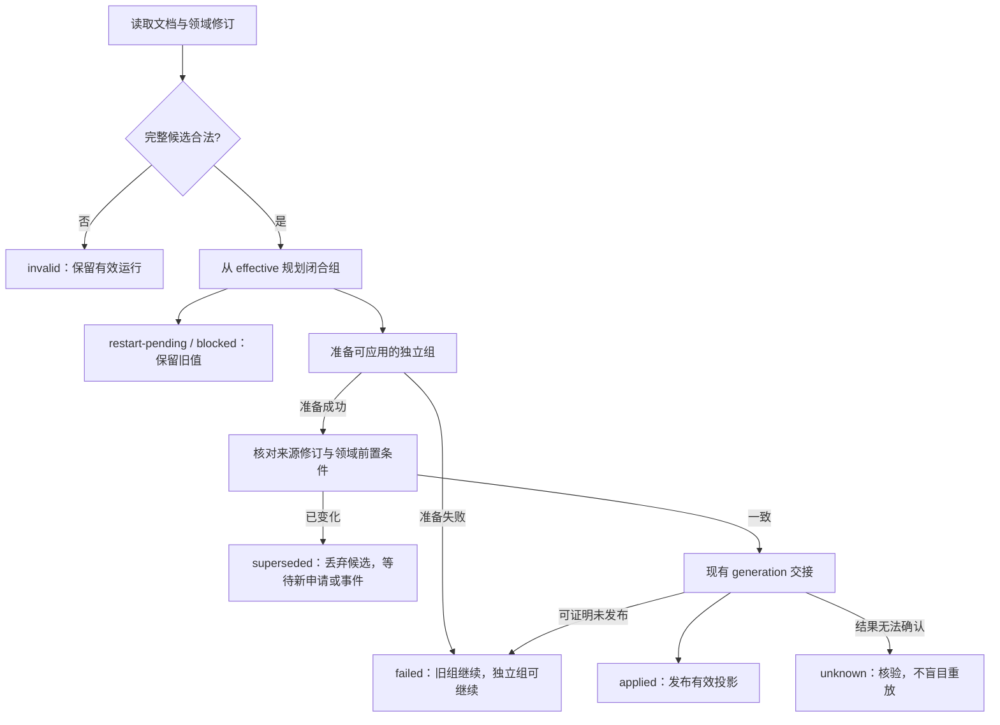
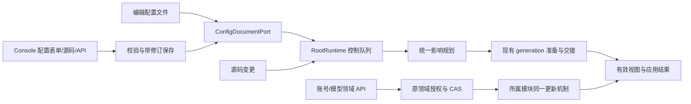

# 配置按需生效技术方案

日期：2026-11-03。状态：用户已批准，[#1139](https://github.com/zhinjs/zhin/issues/1139) 对应实现已完成本地检查与独立复审，尚未据此宣称远程 CI、发布或真实平台验收完成。调研代码基线：`447638ddc0e014425b532cbce56b07fb8607d795`；开工刷新至 `b708d40f154d3558eb90ef2a419b9a623c28ae3c`。本文记录当前实现边界；检查证据见第 15 节。行业依据见[配置来源与动态生效调研](./configuration-update-research.md)。

方案的核心是：**配置存在哪里与如何生效分开；配置所属模块声明更新能力；所有入口共用现有控制队列和 generation 交接。** 先解决生命周期，不建设第二套配置中心。

## 1. 已确认的目标与本次边界

已确认：

- Endpoint 昵称等非连接资料变化不应重启账号。
- AI provider/model 可以动态选择；不为此重启整个进程。
- 同次保存中，可独立应用的部分先应用；必须重启的部分明确保留待生效。
- 源码与配置分开监听，使用 `--watch source config`、`--watch config` 等正向选择。
- 先调研再判断是否接入数据库，不能把“热配置”直接等同于“数据库配置”。

本方案已获准实施，内部接口、分组算法和交接步骤按本文推进。没有授权修改真实账号资料、访问真实模型、自动重启进程、迁移数据或发布；实现进度和验收证据与技术方案审查记录分开。

本轮不做：通用配置数据库表、文件/数据库双模式切换、后台双写、分布式配置广播、集群一致性、凭据库重构、任意插件回调的事务沙箱。已有数据库记录继续由原领域管理；不以热更新为理由要求文件项目安装 SQL。

## 2. 改动前的限制与实现落点

| 当前路径 | 已有能力 | 本次需要改变的限制 |
| --- | --- | --- |
| `ConfigDocumentPort` / `ConfigFileDocument` | 修订检查、保留占位符、候选写入、文件原子替换 | 保存修订不能表达运行状态已经部分应用 |
| `RootRuntime.#planRuntimeInputs` | 输入差异和插件视图规划 | 任意 Host 键变化直接规划进程重启 |
| `RootRuntime.#applyConfigPatches` | 控制队列、影子代准备、交接、子树保留 | Host 变更偏向重建 Root；与文件监听路径判断不一致 |
| CLI `start-command.ts` | 创建 HTTP、数据库、Agent 等 Host 资源 | 部分 installer 捕获启动时对象；仅放宽重启判断仍会读取旧对象 |
| `Adapter.update` | 账号校验、身份检查、CAS、操作结果 | 所有配置更新统一 stop/start，没有非连接资料分支 |
| `EndpointProfileState` | 配置兜底、平台观察值、资料操作 | 配置兜底捕获于创建阶段；应更新投影，不能重建登录态 |
| `ModelRuntimeService` | 逐回合策略、不可变 invocation、修订租约 | 已有运行策略可变，部署模型目录却仍捕获为启动基线 |
| Console configuration store | schema、文件保存、修订校验 | 保存接口与后续 watcher 生效脱节，Host 键只给笼统重启提示 |
| `HmrCoordinator` | 合并事件、串行处理、模块装载交接 | `restartRequired` 锁存会停止后续处理，不适合配置部分待重启 |

对应源码：[RootRuntime](../../packages/im/runtime/src/root-runtime.ts)、[PrimaryConfig](../../packages/im/runtime/src/primary-config.ts)、[HMR](../../packages/im/runtime/src/hmr-coordinator.ts)、[CLI 装配](../../basic/cli/src/plugin-runtime/start-command.ts)、[Console 保存](../../basic/cli/src/plugin-runtime/console/configuration.ts)、[Adapter](../../packages/im/adapter/src/adapter.ts)、[资料](../../packages/im/adapter/src/endpoint-profile.ts)、[模型运行时](../../packages/im/agent/src/model-runtime/service.ts)。

## 3. 配置与记录的归属

### 3.1 不用一个优先级覆盖所有领域

| 内容 | 权威来源 | 变更入口与规则 |
| --- | --- | --- |
| 部署声明、插件拓扑、静态模型目录、Host 启动项 | 当前项目配置文档，秘密保留为引用 | 编辑文件或 Console 配置页；写回同一文件 |
| 持久化管理的 Endpoint desired 记录 | 现有 Endpoint 仓库 | 账号管理 API，保留 CAS、加密和身份验证 |
| 模型运行策略覆写、个人模型、个人会话选择 | 各自现有仓库 | 复用领域 API、权限和继承解析 |
| 平台观察到的账号资料、连接状态 | Endpoint 与平台事实 | 观察/平台操作，不反写成部署配置 |
| 本进程的有效配置、待生效项与处理结果 | RootRuntime 当前运行状态 | 控制队列发布；不是另一个持久化配置来源 |

Endpoint 当前代码是在仓库存在快照时恢复整份 desired 记录，否则使用文件展开的启动种子；不是“逐字段数据库覆盖文件”。本轮保持此规则。修改文件中的账号启动种子不会偷偷改写既有管理记录；界面显示该账号受管理记录控制，并提供账号管理入口。没有持久化快照的文件账号，种子变化才直接作用于该文件账号。

必须区分连接创建默认值与资料继承：`endpointCreationConfiguration` 排除适配器级 nickname/profile，连接默认仅用于新建/替换；`mergeEndpointProfileConfiguration` 则在绑定账号时把当前适配器资料默认值与账号显式值合并，受管账号也如此。资料默认变化应更新仍继承它的账号投影，不写 CAS、不覆盖显式资料、不重连；字段删除恢复继承，null 等有效显式值沿现有规则，不当作缺失。界面分别标注“仅新建使用”和“当前资料继承”。切换文件/管理记录所有权必须另行设计显式迁移，不能在本轮顺便执行。

模型沿 [ADR 0046](../adr/0046-personal-session-model-policy.md) 的解析链：部署基线 → 合法运行覆写 → 精确场景/个人选择 → invocation。修改 YAML 默认模型不会清空显式覆写；结果需说明实际来源、覆盖范围和为何当前会话仍使用其他模型。当前个人存储只支持按身份读取，不能证明已枚举所有个人引用，因此首版不热应用目录项删除、重命名或其他破坏已有引用契约的变化，保留现有重启边界；不自动清理选择或隐式 fallback，也不宣称重启能修复无效引用。

### 3.2 数据库的结论

可以通过已有领域仓库管理账号和模型选择；**不新增“把整个 zhin.config.yml 放进数据库”的能力**。`ConfigDocumentPort` 已经隔离文件实现，未来如有多人配置中心的实际需求，可以另提后端方案。当前端口存在，并不表示现有 Console（具体依赖 `ConfigFileDocument`）已支持任意数据库来源。

## 4. 更新粒度与保守兜底

由字段所属模块提供规则，Root 负责组合；不能在 CLI 写死所有插件字段，也不把 JSON Schema 当作具备更新能力的证明。

| 方式 | 含义 | 交接与旧操作 |
| --- | --- | --- |
| `in-place` | 发布新配置投影，保留账号连接或业务对象 | 新操作读取新投影；已捕获输入不被改写 |
| `replace-resource` | 同一模块的新资源版本 | 新操作取得新资源；旧资源随现有租约释放 |
| `reconnect-endpoint` | 一个账号的连接需重新建立 | 只走既有 Endpoint lifecycle，保留真实身份边界 |
| `reload-plugin` | 对应插件及实际受影响子树重建 | 复用当前 generation 准入、退役和释放语义 |
| `restart-process` | 本进程无法安全替换 | 保存待生效，运行继续使用旧值；不自动重启 |

未声明插件字段维持既有子树重载，不推断为原地更新。未提供 Host 资源更新能力的 Host 字段维持待进程重启。身份变更继续要求显式账号替换，不能用 reconnect 绕开。

首批规则只覆盖明确需求：Endpoint 配置资料投影、模型目录/选择。HTTP 监听、数据库连接、进程启动选项保持原有安全边界。其他字段必须逐项证明更新能力后才新增规则，不宣称所有 Host 配置已经热更。

### 4.1 最小接口与所在层

当前结果类型见 [`configuration-application.ts`](../../packages/im/runtime/src/configuration-application.ts)。`ConfigEffect` 与组结果的核心字段如下；所属资源通过 handler/组 `id` 表达，不另有公开 `owner` 字段：

```ts
type ConfigEffect =
  | 'in-place' | 'replace-resource' | 'reconnect-endpoint'
  | 'reload-plugin' | 'restart-process';

interface ConfigApplicationGroup {
  readonly id: string;          // 稳定的所属资源标识，不由客户端指定
  readonly paths: readonly (readonly string[])[];
  readonly effect: ConfigEffect;
  readonly status: 'applied' | 'restart-pending' | 'blocked'
    | 'failed' | 'superseded' | 'unknown';
  readonly reasonCode?: string;
  readonly dependsOn: readonly string[];
}
```

- 通用类型与只读结果放在低层契约中；无文件、SQL、HTTP 或 AI 依赖。
- runtime 沿 `ConfigPatchPlanner` / `RuntimeInputPlanner` 规划差异与有效投影。Host handler 拥有不重叠路径，每个 handler 必须覆盖一个依赖闭合组；当前没有通用依赖 DAG、自动环检测或跨 handler 依赖调度器。`dependsOn` 是结果合同字段，不代表这些机制已经实现。
- CLI 作为 composition root 给现有 Host installer 配套更新能力；不把 Agent/数据库实现导入 runtime 底座。
- Adapter 负责账号差异分类和资料更新；模型模块负责目录编译、引用和租约，CLI 只装配。
- 插件的 `configUpdate.featurePaths` 是纯声明；只有实际差异全部落在声明范围，且其保留 Feature 的 `prepareConfigUpdate` 全部接受，才保留 setup 并投影新视图。未声明的第三方插件继续重载；没有任意修改外部状态的 `onConfigChanged` 回调框架。

内部 prepared 对象复用 generation 准备/交接/释放流程，不另建全局 registry、独立 reloader 或 mutable latest-value stack。准备阶段只构建未公开对象、校验和取得可释放资源，禁止开始平台资料写入、业务任务或模型请求。同步发布使用现有 `SnapshotStore.commit` 的指针/准入切换；能抛错或产生外部副作用的 SDK 更新不能伪装成无失败的绑定切换。

### 4.2 已实现的纯配置交接路径

原 `SubtreeGenerationPreparer` 保留 owner 时沿用旧 config Map；Adapter 的 `when-owner-unchanged` 又会在其 owner 进入重建 roots 时重建投影。因此实现没有只放宽 retain，而是在 Root 规划和 Feature 投影之间增加了受限 prepared 路径：

1. 将每个 owner 的差异完整交给所属模块判断。只有全部差异都属于已实现的纯资料投影时，才把该 owner 排除出插件重载 roots；如果其他字段或源码也变化，继续原重载路径。由必须重载的祖先覆盖时，也不能单独保留这个 owner。
2. 根据候选 effective 配置重建对应 owner 的验证后 config view，复制写入候选 snapshot.config；投影新的 PrimaryConfig/resources，保留旧 snapshot、旧 Scope 与旧租约。不能只更新 PrimaryConfig 而留下插件 config Map 的旧值。
3. Adapter 投影为当前账号准备绑定不可变 defaults 的资料门面，平台 observed、native 读写序列、账号取消信号与 transport 仍委托同一账号状态。门面从操作持有的 snapshot 解析；不能只更新 config Map，却仍从 `endpointRuntime.selfProfile` 返回旧门面，也不能让旧/new snapshot 共享一个可变 defaults 指针。
4. `GenerationHandoffStack.activateNext` 实际是逐项 await，早于同步 `SnapshotStore.commit`，因此其间只能准备/登记未公开的候选，不能修改共享账号或模型服务的“当前配置”。commit 发布候选 snapshot 后，新操作读取新配置门面，旧操作继续解析自己租约的版本；交接失败只释放候选门面。准备/回滚不调用 SDK、不改变 observed profile、不换账号 epoch。不新增通用公开 commit hook。
5. 不把保留的 Scope.setup 中任意闭包捕获值说成自动刷新。纯更新只作用于声明的 config view 与资料读取入口；需要执行插件 setup 才能改变的字段仍走插件重载。

Root 校验 owner 的纯声明及全部保留 Feature；未保留的 Command 等 Feature 随新代重新投影。第一方 22 个适配器声明经过 setup 审计，见[资料配置审计](./adapter-profile-config-audit.md)。不修改 retain 为无条件保留，不另起一个可变配置单例；源码或祖先变化需要重建时，最终 effect 仍按实际重建结果记录。

### 4.3 保留 Root Scope 时的私有资源版本

原 `RootRuntime` 的 rootResource resolver 只经 `state.model.scopes.get(root).use(token)` 读取私有资源；只改 snapshot.resources 会留下旧模型 baseline，修改保留 Scope 又会污染旧租约。

当前 `RuntimeGenerationState.rootResources` 保存代所属的受信私有绑定，候选准备时复制并替换。SnapshotStore 的受信读取先检查该代绑定，再解析未被替换的 Root Scope 资源。视图按实际 Root-private token 对象校验，不接受同 ID 伪造对象；候选在 commit 前未公开，旧代不被改写，释放仍由 SnapshotLease 管理。

这是一处运行代状态的内部补充，不是新建全局资源注册表或绕过私有 token 的公共接口；public snapshot、子插件、失效或外来 lease 均不能取得这些私有值。实际包依赖保持低层只认识通用 binding，不反向依赖 AI 类型。第一批版本化私有绑定仅用于本方案所需的模型配置，其他资源维持原 Scope 所有权。

## 5. 保存、有效值与部分应用

### 5.1 必须分开的状态

RootRuntime 持有以下进程内状态，随 Root 销毁，不存模块全局：

- `sourceRevision`：本次应用结果实际对应的原始文档修订，不冒充此后外部编辑的新修订。
- 输入状态：文档快照、已加载环境层及模块/schema 视图分别参与重规划，没有对外新增统一的 `inputRevisions` 版本号。环境变化即使没有改 YAML，也不会只按 sourceRevision 去重；不对秘密值输出可供猜测的独立哈希。
- `desired`：该修订完整解析与校验后的期望部署声明；包含原占位符形式。
- `effective`：已成功交接的部署声明及其环境展开结果。它可能来自多次保存的已应用部分，不能冒充某个文件版本。
- 有效环境层：与 effective 一起提交的 EnvStore 输入；与最新读取的期望环境层分开保留。环境组待生效时，下一次源码重载仍用旧有效环境层，不能重新展开成待生效秘密或参数。
- `generation` / `applicationRevision`：运行代与配置应用序号。后者标识一次发布，不替代领域仓库的 CAS revision。
- `groups`：各变更组的 effect、当前结果、原因及依赖字段，共用外层应用的 sourceRevision。记录路径与原因码，不保存展开秘密或聊天内容。

有效配置的来源是一个向量：部署应用序号、模型策略修订、账号 desired 修订等各自保留。不得假设一个数字能够原子代表所有领域状态。

`PrimaryConfig` 和插件 `config` 只投影 **effective**，不能将待重启值混入运行代。原始文件和待生效项经管理 API 单独读取，沿现有配置权限及秘密处理边界。保留 Scope 获得新代的资源视图；旧租约的不可变配置仍保持不变。

### 5.2 从差异得到闭合组

每轮以 **effective → 最新 desired** 重新规划，不只比较两次文件保存。步骤：

1. 读取并记录文档修订；解析、schema 默认值、环境展开、插件图和字段所有权校验。
2. 完整候选无效时不应用任何部分。Console 写入在保存前拒绝；直接编辑的文件保留原样并标记无效，旧有效运行继续。
3. Host 模块注册拥有不重叠路径的 `RootConfigUpdateHandler`。每个 handler 自己封闭引用和共享对象依赖；需要一起发布的值必须归同组。未处理的 Host 路径保守待重启。
4. 当前模型 handler 将 providers、modelCatalog、modelPolicy 和已存在 Agent 的 provider/model/preset 绑定放在同组；新增目录与依赖它的选择同时准备。Agent 安装/绑定拓扑、破坏性目录变更和未满足的环境依赖明确待重启。
5. 以当前 effective 替换可应用组，构造并校验候选运行投影；一个 handler 准备失败保留该组旧值，其他已声明独立的 handler 可继续。不存在自动拆解任意依赖图后再尝试的算法。
6. 插件差异沿既有子树规划；纯资料声明与 Adapter hook 共同证明可以保留。账号角色由 Host 的选择器保留整个相关实例及包绑定，避免发布尚未被进程角色解析器采用的值。
7. 对可发布组合统一准备新代并交接。整代交接失败时此次尚未发布的组均不记成功；已在先前应用轮次成功的独立组不撤销。

独立准备失败的处理不是“忽略任意错误继续启动”。组内必须维持完整有效契约；完整候选本来就非法时，不进入部分应用。

### 5.3 举例

同次修改：`http.port`、文件账号兜底昵称、默认 chat preset。

- HTTP 仍使用原端口，端口组记为待进程重启。
- 昵称投影更新，SDK 连接、账号实例身份和登录态保持。
- 若 preset 存在且依赖可用，下一回合使用新选择；已有回合维持原 invocation。
- 此时保存修订已经更新，运行代只包含昵称与模型的变更。
- 再改一次昵称，仍从 effective 重算，端口继续待重启；把端口改回当前有效值后，其待重启项清除。
- 此后修改插件源码，代码 HMR 以 effective 组装，不能顺便带入尚未应用的端口。

### 5.4 错误与状态机



`invalid`、`failed`、`blocked`、`restart-pending`、`superseded`、`unknown` 分开。只有 `restart-pending` 表示安全应用方式已知且明确需要进程重启；失败不能包装为“重启即可”。

准备失败释放新资源，保留旧配置。文件已保存但激活失败，必须报告“已保存，未生效”；没有跨文件、DB 和 SDK 的分布式事务保证。Endpoint 仓库提交不确定继续走现有 commitId/读取核验，不重放有副作用操作；读取失败不当作记录不存在。断连后重连失败也不宣称恢复了旧在线状态，展示账号实际执行结果。

## 6. 统一入口、并发与源码热重载



- 文件事件是失效通知，不是可直接执行的 patch。进入队列后读完整文件；监听父目录和正式源路径以覆盖编辑器原子替换，沿现有临时文件过滤，不新增定时重试器。
- Console 使用修订前置条件保存；源修订冲突返回冲突，不默默覆盖用户刚保存的文件。有效代前置条件与源修订分别核对，防止“基于旧运行状态预览、对新运行状态执行”。
- Console 保存成功后请求同一配置应用入口，并返回 operation 标识；watcher 仍可发现变化，但全部输入修订一致且有效差异为空时幂等跳过，不能只比较 YAML 修订。配置监听关闭不禁止用户显式请求应用；保存本身与应用结果仍分开。
- 所有运行发布串行进入 Root 控制队列。运行模型策略、个人会话选择及依赖部署目录校验的写入口先经 Root 控制入口，再取得本次目录/权限视图、校验并完成领域 CAS；覆盖 Console、IM 指令/工具和内置调用。锁序为 Root 控制入口 → 领域 mutation/CAS；不持有领域锁反向等待 Root。目录发布与相关写入因此不在校验/提交之间穿插；已有模型回合不持有 Root 控制队列，模型查询仅在必要的短控制阶段取得一致版本。
- 计划准备期间再有编辑，交接前再次核对源修订；不一致则释放候选并报告 superseded，由后续文件事件或显式申请重新读取。领域选择写入与目录发布共用控制序列及领域 CAS。外部文件没有协作锁，无法宣称读修订与内存交接之间不存在时间间隙；应用结果绑定实际读取修订，不承诺全局线性一致。
- 配置的待重启状态移出 HMR 的全局锁存判断，后续配置编辑仍可生效。源码确实无法安全失效的情况仍保留既有保守限制；它与“某配置项待重启”不是同一个状态。
- 源码和配置同时变化时，在控制队列内一起规划；先确定可用模块/schema 版本，再用 effective 加上本次可应用组构建候选。模块/schema 无法安全装载时维持既有失败或重启边界，不宣称任意配置组都能绕过此失败。
- 同组没有无条件循环重试。新来源修订或显式重试请求重新规划；已有领域 unknown 状态须先核验，修订变化不能绕过不确定提交保护。

### 6.1 文件保存与交接的边界

保留 `ConfigDocumentPort.prepare/commit/rollback`，但不再把“原始文档成功落盘”解释为“所有配置成功生效”。Console 流程为：预校验完整候选 → 带修订提交文件 → 排队应用其修订 → 返回保存与应用两种结果。文件写入失败不开始运行发布；落盘结果不确定时先读取核验，不返回虚假的确定失败。

`applyConfigPatches` 与 `RootRuntime.applyConfiguration(expectedSourceRevision?)` 共用控制队列及应用规划，没有另建 Console 专用应用器。原手动 reload 等调用者保留其契约；配置应用结果通过 `configurationApplication` 提供，不能只从 RuntimeSnapshot 推断整个文件都已应用。

文件写入以后，激活失败不自动回写旧文件。需要撤销时，由用户显式提交新的带修订变更。直接编辑的文件从一开始就已经落盘，更不能由 watcher 覆盖用户内容。

## 7. Endpoint：资料变化不等于重连

### 7.1 昵称的实际含义

当前 `nickname` / `profile` 配置是平台资料缺失时的兜底，不是修改真实平台账号资料。热更新保持这个合同：

1. 确认目标是当前文件账号或当前受管 desired 记录，检查实例身份和修订。
2. 若差异只涉及配置资料，准备新的兜底投影，保持平台观察值和资料读写状态。
3. 发布后，新资料读取使用新兜底；已有平台观察值依旧优先。配置昵称改变后仍显示平台昵称，是来源优先级导致，不是热更失败。
4. 不调用 SDK setNickname，不触发平台审批/写入；真正改平台资料继续使用现有资料操作。

文件账号通过 generation 的新资料视图保留连接；受管账号显式资料更新先沿现有 CAS 保存 desired，再应用资料投影。适配器级资料默认更新只刷新继承投影，不写账号 CAS。各入口复用 Adapter 的分类和投影更新逻辑，但保持存储归属。`EndpointProfileState` 分开每代不可变配置兜底门面与可共享的平台观察事实；一次资料读取捕获自己的兜底版本，已发出的消息元数据不被回改。AdapterIndex 的 metadata/profile 以及其他资料读取入口都必须经对应操作的门面，不留直接读取旧 runtime defaults 的旁路。

### 7.2 需要连接变化的配置

资料组不包含凭据、网关地址、协议参数、身份探测字段或身份字段。普通连接修改继续走既有 Endpoint lifecycle，只影响该实例；身份字段保持显式替换。禁用/离线账号更新资料不能顺手启用。

首版不将同一个账号的连接改动与资料改动拆成两次 desired CAS 或重复 SDK 更新；它们可作为一个账号组整体走现有连接更新。保证“只改昵称不重连”，不额外承诺“同时改凭据也能保持原连接”。其他账号和适配器不被牵连。

保留 Adapter 实例及其账号生命周期时，必须更新当前 generation 的绑定与准入，不将新的 config 合入旧租约的 immutable context。需要验证 retained adapter 投影确实保留 transport；只测 `stop` 未被调用不足以证明消息仍正常派发。

## 8. AI：目录版本与回合租约

复用现有 `connection → model → preset → policy → invocation → lease`，不再建一套 provider 选择机制。

### 8.1 动态选择

选择已存在 provider/model 的对外配置最终解析为完整 preset 引用；控制台沿已有运行策略 API 更新，文件沿部署基线更新。它们共享编译器与 resolver，但不自动互写。

下一回合在取得模型执行范围时一次性捕获部署目录/策略基线、运行覆写修订与会话选择。随后取得确定版本的连接租约。同一回合的工具循环、感知、摘要不能在中途各自重新读默认 provider/model，保证现有 invocation 契约。

原链路在异步读取会话选择后再读取模型策略，可能在目录发布时拼出“旧目录+新选择”。当前通过 Host 私有 `createModelConfigurationAccess` 完成以下受限准入，而不增加意图模型或重跑业务：

1. 可信 Host 在现有 turnModelPort 内注入配置准入端口，将“读取完整配置并解析 invocation”进入与目录发布、相关选择写入相同的 Root 控制序列。
2. 在该序列内取得**当前模型配置专用 SnapshotLease**，读取该版本部署目录、个人选择/目录与运行策略，核对可信身份及原消息 binding 的兼容性，一次解析 chat/perception/summary 及已声明 fallback 的不可变 invocation。读取失败、身份不符、旧 binding 已不兼容均报明确错误，不隐式借用别人的模型或另一个 Agent。
3. 返回 Host 私有 execution plan 及其配置租约，退出控制序列；再用现有连接池取得精确 invocation 的资源租约。现有 `acquireForTurn` 包含 secret resolver/factory，不能整体塞进控制队列，更不能持有它等待网络、SDK 或模型响应。
4. 配置/模型资源 owner 的租约覆盖整个执行范围，并在成功、取得连接失败、取消与异常路径统一 finally 释放；连接池的租约不能早于配置版本失去 owner。已取得的 scope 后续不重新做目录/策略解析。
5. 原消息 lease 继续决定业务、工具、权限、审批和取消；专用模型配置 lease 只选取受权模型配置，不替换整条 TurnRequest，不把“当前 Root”变成越代借权入口。端口不向插件暴露裸 Root 私有资源或任意排队执行权限。

启动/配置准备/交接等已处于控制序列的可信调用传递内部控制上下文，Root 验证其身份与有效期；无效/不合法重入被拒绝，不排队等待自身。不新增模块级重入标记，也不在配置激活回调里自动发起模型任务。

标准 Host 消费者已接入同一配置捕获边界：主会话及工具循环、感知/摘要、审批 reviewer、ambient 判断、原生图片主/子工具、Subagent、ServiceAgent 和显式 completion。部署判断仍使用部署模型权限，不借用调用者个人模型；原消息权限、审批和业务取消继续归原消息租约。这个覆盖不等于更新任意闭包：第三方代码或调用方已保存的 SDK/provider 引用保持原对象，需要在新操作时重新通过标准入口取得。

### 8.2 修改连接/目录定义

把当前服务捕获的部署目录改为 Root/资源所属的不可变版本输入，由操作拥有的模型配置 snapshot 解析；保留连接租约管理器与会话状态。不得在异步 activateNext 修改共享服务的 `#compiled` 或全局 current 指针。每个回合捕获一份基线，不能跨 `await` 混合两个目录版本。

- 新增定义及兼容修订先本地编译与验证，校验部署引用与可读取的运行策略，准备相应资源绑定。兼容修订限于保留标识、所有者和已声明能力契约的连接参数/模型参数修订；不能因“ID 相同”就把删除能力视为兼容。个人选择仍由现有逐回合 resolver 完成所有权与引用检查。
- 不为“验证配置”自动请求模型。缺包、未知协议、无效引用等本地错误明确拒绝；网络/凭据真实可用性仍由显式试连或实际请求检验，不能把 schema 通过说成服务可用。
- connection 内容变化产生新 revision；新回合用新版本，旧回合维持已取得的租约。旧资源在最后一个租约释放后关闭，不主动取消已有回合。
- 连接池共享不代表工厂输入读取全局最新值：factory/secret resolver 的 hostFactoryData、privateConfig、模型列表和秘密引用来自该 execution plan 持有的配置版本。版本化运行时复用原连接池，不按 connection.id 回查 latest，也不让新连接沿用启动时参数。秘密解析保持 Host 私有，不放入公开 invocation/日志。
- 不继承旧连接对象中的可变认证字段，不借用其他个人的凭据；模型切换不改变工具、权限、审批或历史。
- 不可动态替换的 AI 子项按所属资源声明保持待生效；不因 `ai` 顶层字段变化一律重启，也不一律假定原地更新。
- 首版目录删除/重命名、所有权变化或破坏已发布能力的修订不热应用，作为未支持的更新方式保留待重启，具体原因标明“缺少完整引用与变更安全证明”。这与非法配置的 failed/invalid 不同；重启也不意味着引用一定可用，个人无效显式引用沿现有合同报错。
- 不以 active Session 目录替代完整偏好索引，不在本轮新建反向引用表或迁移个人状态。若后续要热删除，必须另行设计完整引用发现与原子准入，不能仅在交接前重读几条已知修订。
- 运行策略读取失败保持不可用错误，不当作“无覆写”。纯选择继续执行现有授权、CAS 与显式引用错误规则，并按第 6 节与目录发布协调。

凭据撤销、紧急中断不是本轮新增能力。既有撤销语义若要求立即失效，不能被普通配置租约排空规则覆盖，实施前需逐项核对；有冲突的字段不先标为支持热更。

## 9. 监听参数

| 参数 | 监听范围 |
| --- | --- |
| `--watch source config` | 源码和配置 |
| `--watch config` | 仅配置；不因源码变化重载 |
| `--watch source` | 仅源码；外部配置编辑不自动应用 |
| 不传 `--watch`，或传 `--no-watch` | 均不监听 |

`config` 包含主配置文档和 Root 已声明的环境输入源文件。标准 CLI Host 中，环境层变化保留旧有效环境并报告 `environment-host-consumers` 待重启；因为插件可直接 `env.get()`，不能证明任意 `.env` 改动都可局部应用，也不修改父进程环境。模型 handler 另核对其实际环境引用；依赖已变化变量的模型组报告 `model-environment-pending`，不把新文件和旧秘密拼成可生效结果。

解析器内部改为监听范围集合；复用现有 watcher 和控制队列，改变事件接纳范围，不起第二个调度器。空值、未知值报清楚的参数错误；重复范围归一化。`--once` 保持启动一次并退出，不注册 watcher。

**已确认的 CLI 规则**：用户明确选择“仅显式 `--watch` 才监听”，未指定时源码和配置均不监听。`--no-watch` 保留为不监听的兼容入口，与显式范围冲突时报错；不引入 `--watch none` 或 `--no-config-watch`。新项目的开发脚本显式选择 `--watch source config`。

## 10. Console 与结果合同

配置表单继续以 schema 为输入；独立 Console 的源码编辑沿现有文件管理入口，不另起一套编辑器。Host 协议与对应 UI 成套扩展，不把所有配置转换为独立 CRUD 页面。

一次操作结果至少包含：

```ts
interface ConfigApplicationResult {
  readonly operationId: string;
  readonly sourceRevision: string;
  readonly saved: boolean; // unknown 保存结果使用独立错误/状态，不伪装为 false
  readonly generation: number;
  readonly applicationRevision: number;
  readonly groups: readonly {
    readonly id: string;
    readonly paths: readonly (readonly string[])[];
    readonly effect: ConfigEffect;
    readonly status: 'applied' | 'restart-pending' | 'blocked'
      | 'failed' | 'superseded' | 'unknown';
    readonly reasonCode?: string;
    readonly dependsOn: readonly string[];
  }[];
}
```

这是当前结果合同。RPC 等待应用完成或返回明确的冲突/校验失败/未确认结果；等待期间由 UI 显示进行中，没有额外的公开 operation pending 枚举。`status: 'applied'` 表示取得应用回执，各组仍可能待重启或失败；`groups: []` 且 saved、generation 与文件修订有效时，表示当前文件与运行配置一致，不声称发生了新变更。完整候选校验失败不强塞进组结果。

页面区分“文件已保存”“当前已生效”“待进程重启”“应用失败/不确定”“被其他来源覆盖”。按组显示 effect、原因、路径与文件修订，不只显示一个 restartRequired 布尔值。新协议的重启判断取自实际应用组；旧 Host 缺少明细时仅保留兼容提示，明确无法确认当前运行。

展示中不返回环境展开秘密、密钥内容、完整 SDK 对象或未授权个人选择，沿现有配置读取权限展示元数据。跨文件和领域仓库的读取不输出虚假的统一有效版本。

Console 的 `config:apply` 要求 full scope 与当前文件 `expectedRevision`；与插件管理的 `plugin:apply` 独立，不保存草稿、不重启进程。保存回执另有 `applicationError: invalid | superseded | unconfirmed`，明确文件已经保存但应用校验失败、被替代或结果未确认。UI 按连接与修订隔离证据，未知操作不盲目重放，只读刷新不能丢失在途应用的结果；新修订仍可由用户显式申请。手动应用不受 watch 关闭影响。

没有因 pending 自动重启、自动重试未知投递、弹出周期通知或探活请求。结果只公开 operation、路径、方式、运行代、原因码等元数据，不返回展开秘密；没有新增用于保存完整配置值的诊断表。

## 11. 失败恢复与启动

- 准备阶段：释放新资源，旧代继续。不得停止旧连接后才开始验证昵称或模型引用。
- 同步内存交接：沿既有 generation handoff 保证绑定一致；失败恢复旧绑定，回滚失败不得掩盖原始错误。
- 有外部副作用的连接重建：沿既有账号执行状态报告实际结果；不承诺通用事务回滚，也不把 unknown 自动重试。
- 保存与应用之间崩溃：下次启动读取已保存期望配置，执行完整启动校验；不持久化一份含展开秘密的“最后有效快照”来偷偷降级启动。无效配置按现有启动错误暴露。
- 部分生效后退出：pending 在本进程内有解释记录；重启成功后以完整新配置建立有效基线，待重启状态消除。启动失败不能谎称 pending 已应用。
- 回滚版本：显式提交新修订，走同一校验/应用流程；不是修改内存版本号，也不回滚业务数据。部署旧二进制需要恢复与其 schema 兼容的配置；文件归属规则和既有领域记录不因本方案迁移，因此无需通用数据库降级脚本。

## 12. 实现切片与验收边界

以下获准切片已在独立实现分支完成本地验证，独立 Console 使用配套分支；尚不等于远程 CI、发布或真实平台验收完成。涉及发布包的 changeset 均为 patch，不在 main 提交。

| 切片 | 主要落点 | 必须先证明的行为 |
| --- | --- | --- |
| A. 应用结果与有效基线 | runtime 输入/patch planner、RootRuntime、协议 | 保存与有效值分离；混合 Host/插件变更不夹带 pending；两入口行为一致 |
| B. 统一控制与监听边界 | HMR coordinator、RootHost、CLI options | pending 不锁死配置更新；源码事件不会应用待重启项；仅显式 `--watch` 监听的语义已确认并实现 |
| C. Endpoint 资料原地更新 | adapter、profile、retained generation 投影 | 文件账号和受管账号分别测试，昵称变化保留真实 transport 与准入 |
| D. AI 部署版本更新 | model-runtime、CLI Host installer、策略仓库适配 | 下一回合更新；同回合固定；租约释放、覆写优先级、选择写入协调正确；破坏性目录变化不冒充支持热更 |
| E. Console 完整闭环 | CLI configuration store、console protocol、独立 Console 仓库 | 表单/源码保存与实际应用状态一致；冲突、失败、来源显示可解释 |

A 提供统一有效基线和交接机制，C/D 不另建临时更新入口。B 已按仅显式监听的决定落地。A/E 的协议和 UI 配套，旧客户端仍有缺少应用证据的清楚提示。

### 12.1 集成回归矩阵

| 场景 | 断言与证据边界 |
| --- | --- |
| 仅昵称变化 | stop/start/SDK 资料写入均为零；账号身份/连接不变；后续真实 dispatcher 派发及统一发送链正常 |
| 配置昵称被平台昵称覆盖 | 新兜底已发布，展示仍为平台事实，来源准确；清除平台事实后按既有契约读取新兜底 |
| 离线/禁用账号、同改凭据 | 资料更新不启用账号；连接修改仅该实例进入既有 lifecycle；不放宽身份替换检查 |
| Endpoint 管理记录存在 | 文件种子变化不覆盖快照；管理 API CAS 冲突、unknown、读取失败保持原意义 |
| 适配器资料默认与账号显式资料 | 文件/受管账号继承新默认且不写 CAS；显式值仍优先，删除显式值恢复继承；连接创建默认变化不波及已有账号 |
| AI 切换与长工具回合并发 | 使用 fake provider 捕获实际目标与 revision：旧回合全程旧模型，新回合新模型，最后租约释放后才关闭旧资源 |
| 新增/兼容修改 provider 与 model | fake factory 断言实际 hostFactoryData/privateConfig/模型参数/秘密引用均属所选版本；旧租约仍用旧版本，公开结果无秘密，不只检查 resolver 返回的名字 |
| 新目录与新选择、破坏性目录变化 | 新定义与选择依赖组同次发布；非法引用拒绝；覆写不被抹掉；删除/重命名等明确待重启且不声称已完成全库引用证明 |
| 目录发布与模型选择并发 | Console、IM、内置写入口在统一队列内重新验证目录后 CAS；测试可控屏障验证“旧目录校验后、发布新目录前”的提交不穿插，且不存在反向锁序 |
| 目录发布、会话选择与下一回合准入并发 | 不出现旧目录+新 preset 混用；工具/权限仍归原消息 lease；连接 factory 被阻塞时 Root 仍能处理配置，失败/取消释放专用配置租约；启动/控制阶段重入不会自等 |
| 昵称+模型+HTTP 端口混合保存 | 两个热组生效，端口保留；后续再改、回退端口、源码 reload 都不夹带 pending |
| 独立资源准备失败 | 保留失败闭合组的旧资源，独立 handler 可继续；没有通用 DAG 调度承诺，交接失败不误报成功 |
| 并发 Console、编辑器 rename、应用中再次保存 | revision 冲突可见；不覆盖外部编辑；superseded 候选释放；最新事件最终重新读取 |
| HMR/取消/Root dispose | 操作租约、旧 Scope、Endpoint 准入与资源释放符合原合同，不出现双调度、重复登录或重复发送 |
| 异步 handoff 尚未 commit、后续 participant 失败 | 使用可控屏障：旧代读取仍为旧资料/模型配置；失败后候选配置从未对旧代可见；成功 commit 后新/旧租约分别读取自己的版本 |
| 监听范围与 --once | 各范围仅接纳对应变化；显式应用不受 watch 关闭误拦截；once 不留 watcher |
| 仅环境文件变化、环境项待生效后源码重载 | YAML 修订不变也重新规划；旧有效环境层保持，配置/EnvStore/Host 资源不会混用两套值；诊断不泄露秘密或秘密哈希 |
| 秘密及跨域权限 | 原占位符保留；日志/状态无展开密钥；个人模型引用不越权，配置更新不改变工具审批 |
| 无 SQL 的文件项目 | 文件账号资料、部署模型配置热更不隐含依赖 SQL；受管能力不可用时不自动换数据库 |
| 保存后崩溃/重启失败 | 新进程完整校验已保存文档，不读隐藏秘密快照；pending 只在实际启动成功后清除 |

实际新增边界回归包含资料更新引起的 stop/start、旧租约兜底污染、纯更新 owner 的新 config view、模型版本与选择写入并发、Console 保存丢失应用元数据、空组误判未知、读操作淘汰在途 apply 结果，以及旧保存回执覆盖同文件的新运行证据。独立复审发现的问题已补失败回归并修正；其中 UI 与资料边界记录了修复前红、修复后绿。矩阵中的 SDK 及模型调用以 fake SDK/provider 或本地 HTTP fixture 覆盖，不能据此宣称真实账号或外部服务通过。

最低检查：受影响包类型检查/构建、实际入口集成回归、架构与 generation 生命周期门禁、Console 协议/界面检查、文档链接和配置说明检查。跨平台 SDK 的连接复用需在有授权的真实账号环境追加验收；fake endpoint/provider 通过不能标为实机完成。

## 13. 当前保留的边界

已批准范围支持新增、兼容修订和动态选择，不包含破坏性模型目录热删除；第三方插件未声明且未由 Feature 证明可纯更新时仍按原子树重载，不承诺任意插件都能原地更新。这两项沿现有安全边界，不新增文件编辑禁令或存储迁移。

CLI 监听默认已按第 9 节确认，方案已获准实施。自定义 configResolver、非文档 Root 的来源与保存合同不在本轮范围，不能把文件型 Root 的读写行为强加给它们；已有启动/重载保持原合同。

技术与实现审查通过表示被审范围内未发现残余阻断，不表示所有 SDK 都支持动态配置、远程 CI 已通过或真实账号已验收。后续整合仍需刷新 main 与在途 PR，复核并发改动和完整 CI。

## 14. 技术方案阶段的审查与检查记录

两位独立子 agent 分别审查生命周期/并发可实施性和需求/来源/权限合同，初审提出阻断，修正后逐轮复审，最终均明确通过。审查修正包括：

- 区分账号连接种子与资料继承，保留受管账号的资料默认继承。
- 撤回现有存储无法支撑的完整个人模型引用枚举承诺，明确首版破坏性目录更新的边界。
- 补齐 retained owner 的 config Map、资料门面和私有模型配置视图。
- 区分异步 activateNext 与同步 snapshot commit，保证候选不提前泄露给旧操作。
- 将模型选择写入和配置准入协调到同一控制序列；网络/factory 不占用该序列，原消息授权不被替换。
- 明确有效环境层与全部输入修订；连接工厂和秘密解析也必须使用所选配置版本，不能只改 resolver。

方案阶段的文档链接、导航孤页与空白检查通过；当时仅新增本文与调研文档，尚未修改运行代码或执行新增运行测试。以下记录其后实现阶段的证据，不能将两阶段混为一次验收。

## 15. 实现审查与本地验证记录

实现阶段的两位独立 reviewer 分别核对运行时/Adapter 生命周期与模型/Console 边界。复审推动修复了纯更新候选泄漏、多 Feature 配置视图、模型标准入口遗漏及环境依赖、Console 空组语义、应用/读取并发和用途页旧回执覆盖新证据。最后一次 Console 增量复审独立运行 17 项回归通过，未发现残余阻断。具体资料范围另见[第一方适配器审计](./adapter-profile-config-audit.md)。

| 证据 | 本地结果与实际范围 |
| --- | --- |
| 主工程受影响测试矩阵 | 6,567 passed、17 skipped；跳过项不算通过，fake SDK/provider 不等于真实平台验收 |
| 主工程构建 | CI 选择范围对应的 104 包构建通过；这是一轮本地构建，不是 GitHub Actions 结果 |
| 静态门禁 | 架构、SSOT/模块边界、API、Feature、依赖与发版计划检查通过；API 文档检查按真实新增声明登记后覆盖 13 个模块，没有删除断言 |
| 实际 CLI 子进程 | 4 个本地用例通过，包含仅显式 watch、配置/源码范围与环境依赖边界；没有使用真实账号 |
| 自变更保存调用方 | 11 文件、285 项回归通过，其中 23 项覆盖真实 Console Store→Host 端口→Applier；修前复现重复应用、未知结果误报、恢复回执丢失及多段校验异常丢失已确认修订，修后通过。新增恢复/归属用例仅记修后通过，未将其冒称全部红绿对照 |
| 独立 Console | 661 项测试、TypeScript 检查与生产构建通过；包含真实 hook/JSX 边界回归 |
| 跨仓打包契约 | 将主工程协议/客户端打包到临时目录，再独立安装并构建本轮 Console，发布契约检查通过；没有执行发布 |
| Console 可见行为 | 隔离 Chrome 加载最终生产 dist，经 127.0.0.1 合成 Host 的 12 个场景通过；校验保存 CAS、显式应用、空组、混合结果、失败/未知/被替代、旧来源/旧 Host、用途页同版本刷新、中英文和 390px 布局；无页面异常，保留已加载 JS 哈希与截图 |

对应实现回归可从 [Adapter 配置更新](../../packages/im/adapter/tests/configuration-live-update.test.ts)、[第一方多 Feature 配置投影](../../packages/im/runtime/tests/config-profile-first-party.test.ts)、[模型消费者](../../basic/cli/tests/plugin-runtime/agent/model-consumers-configuration.test.ts)、[模型配置准入](../../basic/cli/tests/plugin-runtime/personal-models/configuration.test.ts) 和 [Console 应用协议](../../basic/cli/tests/plugin-runtime/console/configuration-application.test.ts) 阅读。

Console 配套 [PR #52](https://github.com/zhinjs/console/pull/52) 的 `db4f37e` 提交已通过远程检查；主工程 PR 的 review、冲突和完整 CI 仍需以提交后的实际结果另行核对。本地绿色检查不替代这些环节。

上述记录没有执行生产配置修改、真实账号发送、真实模型可用性验收、发布或部署。数据库仍由既有领域拥有，本轮没有通用配置表或数据迁移。
