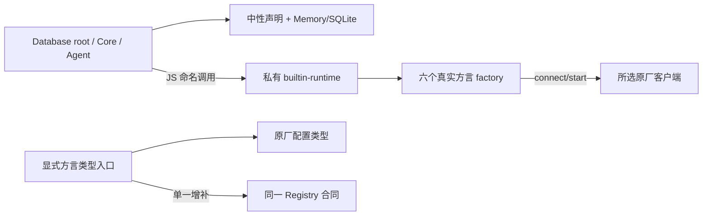

# 数据库可选方言类型隔离

用户已确认方案 B：默认声明中性化，外部方言选择精确子入口；保留 root 自动注册、同步 Registry.create 与连接时才加载客户端。设计稿原始 SHA256 为 `33039b967b8407004472ccdbaab9360e48de658cb6f447b15872ebae496b2b5d`，本文件记录实际实现与验收，不改写该设计证据。

## 公开合同

- `@zhin.js/database` 保留中性数据库、模型、事务、迁移、结构化表工具与 Memory/SQLite。Core/Zhin 继续转出这层，不再携带未选驱动的声明。
- MySQL、PG、MongoDB、Redis 类及完整原厂 Config 从 `@zhin.js/database/dialects/mysql|pg|mongodb|redis` 导入。其配置仍继承原厂类型，没有替换成宽 Record 或删减原厂字段。
- 使用远程 `Registry.create()` 的 TS 作者显式引入对应类型入口；CLI 的 YAML/JSON 配置不变。
- 第三方只在 `@zhin.js/database/registry` 增补真实 Databases<S> 与 Registry.Config。该子口 types 指唯一 registry.d.ts，runtime 指 root，避免先注册后加载 root 时覆盖用户 factory。
- `@types/pg` 保持原有 devDependency，不增加 optional type peer。选 PG 类型的 TS 消费者显式安装匹配的声明，JavaScript-only PG 用户仍只需 pg。驱动版本范围、连接池参数和重试没有改变。
- 新入口最低 `@zhin.js/database >=1.1.6`，当前为待发布 patch；本次只写 changeset，不 bump/publish。同步更新相关 Core/Agent/Zhin patch 的依赖链，不能让新插件依赖仍未提供子入口的旧数据库包。

## 声明与运行边界

registry.d.ts 只保留 Memory/SQLite 映射。所有 builtin 注册从各类模块末尾集中到 root 的内部命名 bootstrap，保持原顺序和同一 Map；bootstrap 不进入 root 声明，也不提前导入原厂客户端。没有增加异步工厂、第二份注册表、自动安装或重试。

根 tsconfig 新子路径只供源码作者的同一模块身份检查；正式隔离验收在真实 tgz 的独立 NodeNext strict 消费者中执行，不用这些源码路径。现有 Database root 条件顺序不变，不能把 `--conditions=development` 命中旧 lib 的结果当源码测试。

## 验收入口

先按仓库正式构建，再运行 `pnpm check:database-types`。该显式本地检查复用现 workspace 打包闭包，正常 pack 实际库，并在临时目录安装当前已锁版本；不添加 CI required job 或修改 check:all 清单。

矩阵覆盖：无四库的 Database/Core/Agent/Zhin 宽入口、真实 Factory/DefinitionObj/第三方增补、每种单驱动完整原厂选项和具体类/表结构正负类型、只有所选 leaf 的声明清单、ESM/CJS 同一 Registry、六种同步 factory、四个缺客户端的启动错误，以及真实 Memory/SQLite 的 start/CRUD/stop。没有真实外部数据库或 Provider 调用。

## 证据记录

- 基线的实际 26 包 Agent 归档 strict 检查报四个 TS2307（mongodb/mysql2/pg/redis）。只替换独立 consumer 内的 Database 正常 tgz 后，原三作者入口 strict 与四 runtime import 通过；旧 consumer 及其证据未被覆盖。
- 新公共入口测试在原实现 2 失败／7 通过，修复后 9 通过；Database 原回归全部保留。
- 正常打包 29 个真实包的独立归档矩阵通过：默认宽入口、四个单驱动、缺 PG 声明以及只有 PG 声明的消费者分别执行 NodeNext strict；声明文件清单确认未选方言不进入默认请求。实际 ESM/CJS、六同步 factory、缺 SDK 错误及 Memory/SQLite CRUD 均通过，外部数据库连接和 Provider 请求均为零。固定证据目录：`zhin-database-types-VqYNSE`。
- Database 回归 158 通过／7 个既有实机用例跳过；CLI Host 与 AI memory 24 通过／1 个实机用例跳过，六个真实方言构造保留同步创建与原配置。根 type-check、局部 TS lint、架构、文档及发布计划检查通过；脚本遵循现有 ESLint 忽略策略，不把它计作 lint 覆盖。
- 这些是本地源码与发布归档证据，不代表 CI、发布、真实外部数据库或 Provider 验收；合并其他已批准修复后的全仓门禁仍由最终候选单独执行。
