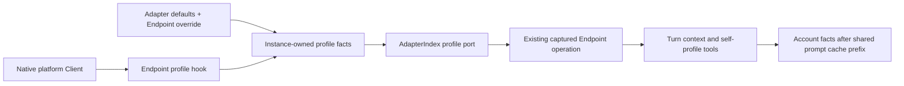

# Endpoint self profile

## Confirmed scope

An Agent speaking through an IM account must know that account's own profile. A configured
Agent nickname is a fallback, not the source of platform identity. SOUL.md uses first-person persona
prose without nickname interpolation; account facts are supplied separately. Requested facts are nickname,
gender, age, birthday, signature, avatar, interests and biography. Profile reads need no approval;
platform writes retain the existing `identity` risk and approval policy. No autonomous
profile-changing trigger, polling, retention rule or new account selector is introduced.

Each field uses platform evidence first. Only missing fields use configured fallbacks; an explicitly
empty platform signature, empty interests, or unknown value must not resurrect a configured value.
Endpoint configuration overrides Adapter defaults field by field. The existing AI nickname remains
the final nickname fallback for non-IM or unconfigured accounts. Platform nickname and group card
are separate facts. Internal task agents keep their role identities.

## Prompt wording

Write instructions as direct imperatives, addressing the Agent as needed. SOUL is first-person
personality prose; an opening self-description establishes the voice without repeating “I” in every
line. Account facts remain a single structured, source-labelled turn block. Preserve speaker voice
in history, quotations and tool results. Parenthetical directives follow the surrounding instruction;
ordinary annotations do not require a pronoun. This is a writing convention, not a runtime rewrite
of user content. Shared style/safety guidance is injected only by the final request assembler;
Skill catalogs share one loading hint. Delegated tasks carry an explicit role, retain operational
workspace and safety rules, and do not inherit the parent account persona. Scene style rules own
response length and narration; generated templates no longer require a generic pre-action preface,
and the task workflow no longer imposes a four-line limit. Existing workspace files are not rewritten.

## Existing limitations

The IM ingress previously supplied the account ID and selected group facts, while prompt assembly
used `activeBinding.nickname`. Most adapters exposed their account instance ID through `name`;
that value must remain a routing/display identifier. Direct SDK setters existed on some platforms,
but there was no common profile capability with capability discovery, error meaning and scoped
execution. A persona-only change cannot fix these call paths.

## Ownership and interfaces



- `im-contract` owns the data and operation interfaces; it has no SDK or Agent dependency.
- `EndpointHooks.profile` supplies native `current`, `read` and optional `write`, plus actual
  writable fields. Unsupported and not-yet-implemented operations are not advertised as setters.
- Adapter runtime owns observed facts for one Client incarnation. Normal reads reuse that
  incarnation's successful observation; changed native facts write through and explicit tool reads refresh. There is no new TTL, timer,
  global cache or profile database. Failed reads throw and never become successful empty results.
- `AdapterIndex.profile` uses the same Client leases and caller cancellation as control and
  management. `CapturedEndpointOperation.profile` retains the same original account and Root.
- CLI binds the source port to the Turn. Tool context carries the port rather than resolving
  the latest account by name. Replaced accounts cannot inherit these facts or execution authority.
- Agent serializes profile facts as data and preserves source labels. Dynamic account facts must
  not alter the shared cross-account prompt prefix or the global `activeBinding`.

Conceptual call flow:

```ts
const operation = im.endpoints.captureOperation({ target, client, signal, requester });
try {
  const profile = await operation.profile?.read({ signal });
  // Compose only this turn's effective nickname and structured account facts.
  await runTurn({ contextState: { bot: { profile } }, ports: { selfProfile: operation.profile } });
} finally {
  operation.release();
}
```

The read result includes `values`, per-field `sources`, `writableFields` and `platformStatus`.
Account IDs remain authoritative login facts; configured display values cannot replace them.
Age is independent of birthday. Changing an age never fabricates a birthday. Avatar facts contain
URLs, never image bytes. Avatar inputs resolve existing authorized assets and media paths behind
the ordinary identity approval and network/filesystem policies.

## Modification outcomes

The write tool changes one field per invocation. This avoids pretending that independent platform
calls are an atomic multi-field update. Native rejection, confirmed update and unknown outcome are
distinct. A successful SDK promise whose value is `false` is a rejection. No automatic write retry
is allowed after timeout or cancellation. A read failure after a confirmed write does not undo or
repeat the write, nor report an unconfirmed readback as verified platform facts.

Existing SDK/native methods remain unchanged. In particular the installed ICQQ 1.12.3 birthday
setter has incorrect month/day substring calls; the adapter must not advertise this unsafe setter.
Age remains readable. A dependency fix or separately reviewed implementation is needed before
enabling birthday writes on that version.

## Verification and delivery

1. Shared contract: platform/default precedence, empty values, per-field merge, immutable snapshots,
   receiver preservation, concurrent read/write ordering, failure and cancellation.
2. Platforms: actual SDK/request mapping and response codes, writable-field accuracy, account and
   transport variants. Protocol fixtures are local evidence, not real-account acceptance.
3. Core/CLI: retain/release, HMR, explicit stop, replaced account and source-profile binding.
4. Agent: read/write disclosure, identity approval, profile JSON, verbatim first-person SOUL, internal role
   preservation, multi-account isolation and stable cache prefix; no inline avatar in history.
5. Configuration: actual adapter schemas, Console projection and generated references.
6. Review the complete diff and affected callers; run focused regressions, type/lint and required
   project gates. Remote push/PR, release and live-account acceptance are separate actions.

## Additive compatibility boundary

This batch remains an npm patch. Planned minimum versions after the normal release step are:

| Package | First profile-capable version |
| --- | --- |
| `zhin.js` | `1.1.20` |
| `@zhin.js/core` | `1.1.55` |
| `@zhin.js/adapter` | `1.1.27` |
| `@zhin.js/im-contract` | `1.1.10` |
| `@zhin.js/tool` | `1.1.14` |
| `@zhin.js/agent` | `1.1.46` |
| `@zhin.js/cli` | `1.1.27` |

These versions have not been bumped or published in this worktree. Adapter Feature API `2.1.0`
adds profile ports; Tool Feature API `1.1.0` adds bound profile context and availability facts.
New Core and official Adapter consumers require `^2.1.0`; new Tool consumers and scaffolds require
`^1.1.0`. Existing `^2.0.0` / `^1.0.0` consumers remain compatible with the newer providers.
Admission checks reject an explicitly older provider before module evaluation or platform login.
Upgrade the related packages and lockfile together; no runtime compatibility shims are added.

Private image scope now includes the full canonical Endpoint, parent/thread, base Session and
principal. Older IM records contain only a lossy hash, so their original full ownership cannot be
proven. Their files and original expiry/capacity accounting are preserved; recapture the image
before using it. Unchanged non-IM scopes remain readable. No automatic historical rebinding occurs.
