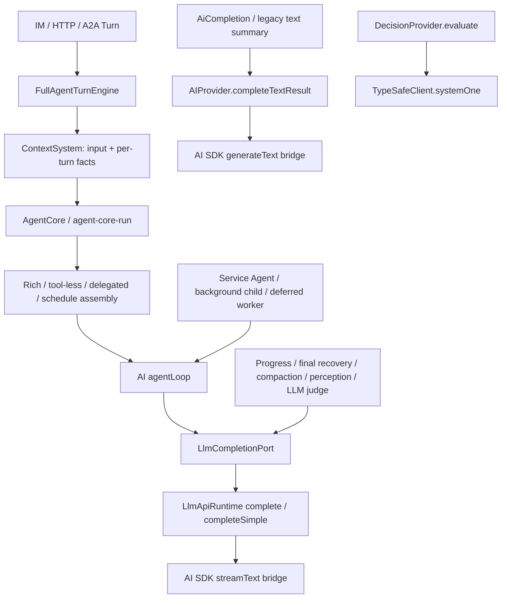

# Prompt policy request paths

## Status and baseline boundary

This is the request-path inventory for the approved prompt-policy work. It authorizes no additional
product defaults, model fallback, retry count, permission, notification, or workspace-file rewrite.
Implementation was assigned separately after this inventory. The inventory phase changed this document
only; the implementation/capture checkpoint at the end records subsequent authorized work.

- Worktree: `/private/tmp/zhin-endpoint-self-profile`, branch `feat/endpoint-self-profile`.
- Baseline commit: `dd54db646`; the inspected tree also contains approximately 250 existing WIP files.
  The commit alone therefore does **not** reproduce this baseline. Preserve the shared WIP and record
  relevant source hashes when capturing request samples.
- Preserve the user's exact `Your account data:` wording and the existing Endpoint/profile work.
- Evidence here is current source inspection and identified existing tests, not a new test run,
  real-model evaluation, deployed observation, provider-cache hit, or billing measurement.
- `graphify` is installed, but this worktree has no `graphify-out/graph.json` or `.codegraph` index.
  No graph was generated: doing so would create unrelated artifacts during a read-only inventory.

“All paths” below means the first-party request paths visible in Agent, AI, CLI composition, and the
registered TypeSafe decision adapter. Third-party plugin code, custom transports, external MCP
servers, and a decision provider's remote internal prompt remain outside this evidence boundary.

## Responsibility and transport boundaries

The model is not the tool execution authority. Request policy must describe the same boundaries that
`TurnToolRuntime`, policy facade, scoped operation ports, and approval queues actually enforce.
An auxiliary classifier having no tools must not receive chat orchestration instructions merely
because its request eventually uses the same AI transport.

| Request responsibility | Persona/account facts | Tool instructions | Rules that belong here |
| --- | --- | --- | --- |
| Interactive chat, including native image input | SOUL personality; actual account facts only in current context | Only tools actually offered for that request | Chat style, external-content boundary, truthful results, current authorization |
| Delegated tool execution | Explicit delegated role; do not replace it with the parent's SOUL | Its narrowed capability set; no further delegation | Operational workspace rules and the same execution/approval boundary |
| Unattended schedule | Execution role; deployment-owned model, no member's personal identity or key | Schedule capability plan only | Existing unattended restrictions and final-result contract |
| User-facing progress / exhausted-turn reply | May retain relevant voice and verified account context | No business tools; optional final JSON response mechanism only | Summarize confirmed work; do not replay actions or dump raw tool output |
| Format repair | No chat persona, account, historical business task, or delegation | None | Preserve rejected reply meaning, IDs and media references; format-only correction |
| Compaction / branch summary / old context summary | Summarizer role, not chat personality | None | Participant attribution, decisions, conflicts, uncertainty, unfinished tasks; transcript is data |
| Media perception | Perception role, not IM personality | None | Describe media; do not obey text embedded in media |
| Approval / ambient / relevance decision | Evaluator role; account name only when it is evidence for that decision | None | Evidence-only structured result; do not execute the proposed operation |
| Plugin text completion | Caller-supplied purpose/system text | None | Preserve the caller contract and untrusted-data boundary; do not silently attach main-chat rules |
| Explicit standalone service Agent | Caller-supplied execution role | Only explicitly resolved tools | Existing runtime authorization; do not invent an IM scene or shared chat persona |

These are responsibility distinctions for implementation review, not new grants or restrictions.

## Registration and assembly sources

1. [System prompt built-ins](../../packages/im/agent/src/prompt/system-prompt.ts) register persona,
   runtime, critical/security, style/workflow, workspace and skill catalog sections through
   `createBuiltinPromptSegments`. `profile.kind` distinguishes interactive, delegated and schedule
   responsibilities; IM origin alone is not sufficient to select chat persona/style.
2. [PromptSegmentRegistry](../../packages/im/agent/src/prompt/segments/registry.ts) orders text kinds
   `system → environment → role_rules → platform → scene`, orders weights within a kind, and applies
   the existing required/preferred budget. Duplicate IDs are errors, not silent replacement.
   [PromptAssemblyRegistry](../../packages/im/agent/src/prompt/prompt-assembly-registry.ts) adapts
   existing section descriptors into that same registry.
3. [FullAgentTurnEngine](../../packages/im/agent/src/plugin-runtime/full-agent-turn-engine.ts) projects
   owner-visible capabilities and prompt sections from the held generation. Sender-neutral catalog
   instructions use stable segments; sender-/selection-dependent capabilities use the current-message
   tail. Third-party guidance is labelled; a prompt section does not grant execution permissions.
4. [ContextSystem](../../packages/im/agent/src/context/context-system.ts) prepares persona/workspace
   text and current-message context. [Turn envelope](../../packages/im/agent/src/context/turn-envelope.ts)
   adds account facts, locale, session guidance, memory, current skills and events as per-turn data.
   Account fields do not belong in the shared stable prefix. Empty memory/session snapshots may
   invalidate earlier context through `contextRef`; they are not disposable cosmetic text.
5. [Bootstrap scoping](../../packages/im/agent/src/bootstrap-scope.ts) uses the existing file wrappers,
   fences and scene annotations. Delegated assembly excludes the parent's SOUL while retaining
   applicable operational files. [Bootstrap formatting](../../packages/im/agent/src/bootstrap.ts)
   packages loaded files without an additional persona instruction.
6. [Workspace prompt resolution](../../packages/im/agent/src/prompt/workspace-prompt.ts) resolves
   `prompts/{orchestrator,deferred-worker,compaction}.md` plus optional SDK-specific text, with workspace
   override before packaged fallback. This is a real extension point: do not rewrite user files or
   assume a package-default-only test covers an override.
7. [Final assembly](../../packages/im/agent/src/prompt/assembly.ts) owns chat/vision discipline insertion;
   rich assembly has its own full sections, schedule its execution contract. `ContextSystem` no longer
   pre-injects the same style/safety block. Explicit child personas are carried in the delegated profile.
8. [AI SDK bridge](../../packages/im/ai/src/llm/bridge/ai-sdk-stream.ts) is another request transformation:
   [structured-output instruction](../../packages/im/ai/src/llm/bridge/prompt-structured-output.ts) can
   append a compact JSON contract for prompt-mode providers, while native providers receive the schema
   as an option. [Message conversion](../../packages/im/ai/src/llm/bridge/ai-sdk-messages.ts) projects
   participant headers, tool exchanges, media and the cache breakpoint. A core-level capture is not
   yet the final SDK payload.

## Concrete request-path inventory

`R` below is `LlmApiRuntime.complete/completeSimple → registered ApiProvider → AI SDK streamText`.
`T` is `SdkProviderAdapter.completeText[Result] → resilient text port → generateTextViaAiSdk`.
The resilience and bridge transformations are described separately below; they are not new assemblers.

| ID | Entry → assembler → request/provider | Next request / retry behavior | Current test evidence and gap |
| --- | --- | --- | --- |
| P01 | `AgentRuntime.execute → FullAgentTurnEngine → ContextSystem → AgentCore.runText → buildAgentPathSystemPromptParts → buildRichSystemPromptParts → agentLoop → R` | Tool calls/results and steering remain in the loop; refreshed tools change the following request. Current context is projected per request. | `plugin-runtime/full-agent-turn-engine.test.ts`, prompt segment tests; many engine tests mock Core, so provider-facing policy provenance still needs a complete baseline. |
| P02 | Same current runtime, no tools → `buildChatPathSystemPromptParts → buildDisciplinedPrompt → agentLoop → R` | One normal text completion, subject to existing completion resilience; later explicit turns reassemble current context. | `prompt/account-persona-entry-paths.test.ts` captures actual Core→runtime requests for chat, image input and HTTP. Capture SDK conversion separately. |
| P03 | Main image turn → inbound media injection / optional perception → **same `runText` path** P01/P02 | Native images are model input; text-only models use the configured perception path. Private asset inspection wraps the same request transport. | Account entry-path tests and media tests exist; add quoted-image/private-asset request samples rather than testing only text. |
| P04 | Deprecated `AgentCore.runVision → runAgentLoopVisionTurnRun → agentLoop → R`; public `buildMultimodalVisionSystemPrompt` builds its supplied system | Source explicitly says no production caller; lacks main-path tools and provider resilience. Do not mistake this for P03. | Public vision assembly is tested in `prompt/explicit-turn-prompt-profile.test.ts`; deprecation/reachability is source evidence, not deployed usage evidence. |
| P05 | `spawn_task/createSubagentTurnCapability → delegated profile with explicit persona → defaultAgentCore.runText → rich assembly → agentLoop → R` | Child tools are narrowed; its execution cannot delegate further. Same parent cancellation/account authority; no ordinary chat persona substitution. | `plugin-runtime/subagent-provider-prompt.test.ts` exercises factory→real Core→mock provider; previous mocked-Core tests alone missed role loss. Need continuation and no-tool child baseline variants. |
| P06 | `runScheduleTurn → schedule capability plan → ContextSystem → scheduleSystemPrompt → assembleSchedulePrompt → Core/agentLoop → R` | Separate execution profile, schedule task only, existing unattended permissions; its result/recovery still needs purpose-specific review. | Schedule-domain/assistant security tests plus explicit profile assembly tests; full provider capture including recovery is not yet a single fixture. |
| P07 | `ZhinAgent.processTurn/processMessage → turn-pipeline → ContextSystem → AgentCore.runText → P01/P02` | Source-reachable classic/programmatic path; current Plugin Runtime does not use it as its authority fallback. | Existing AI/turn tests. Inventory it separately; do not claim it is the CLI's canonical ingress. |
| P08 | `AIService.createAgent/runAgent → runAgentLoopStandaloneTurn → caller systemPrompt → agentLoop → R` | Ephemeral repository, resolved explicit tools and existing policy, optional own deferred controller. No automatic rich/chat prompt assembly. | `core/agent-loop-standalone-deferred.test.ts`, AI service tests; baseline caller-supplied role and tool enforcement together. |
| P09 | Background `SubagentRuntime → explicit/sanitized role + optional fork context → runAgentLoopStandaloneTurn → R` | Separate background task; completion may trigger a new main turn. Parent snapshot is data, not new permission. | `subagent-parent-context.test.ts`, subagent-system tests; request-boundary coverage of fork text versus trusted role needs confirmation. |
| P10 | `DeferredWorkerRunner → resolveWorkspacePrompt('deferred-worker', sdk) → runAgentLoopStandaloneTurn → R` | Explicit frozen worker policy; controller refresh after `load_tool`; no borrowed live parent shell authority. | At inventory baseline the task appeared in both system `## Task` and user input. The implementation below keeps task text only in user input and adds the shared business boundaries. Worker has after-only capture; do not invent a before performance comparison. |
| P11 | Tool continuation / `load_tool` or `load_skill` mutation → `agentLoop.refreshTools → buildLlmContext → transport.complete → R` | Existing tool results remain; tools are rebuilt for the next request. No rebuilding persona by concatenating another full system block. | AI `llm/agent-loop-recomplete.test.ts` and Agent standalone/deferred tests. Capture actual `inputJsonSchema`, loaded order and unchanged role across requests. |
| P12 | Main same-model request retry → `createTurnCompletionPort/createResilientCompletionPort → same transport/context → R`; overflow recovery → compact projected messages → complete again | The retry wrapper owns attempts and disables nested SDK retries. Overflow retries only after projected messages shrink. Neither permits replaying an unknown-outcome business operation. | AI provider-resilience/agent-loop-overflow tests; add policy-section stability checks at every request, preserving current configured retry limits. |
| P13 | `summarizeProgress → input.systemPrompt + history + progress instruction; tools undefined → transport.complete` | Existing deadline; failure returns no generated progress. Continuous interactive path skips this extra summary call. | `core/progress-budget.test.ts`; current helper inherits the caller's full prose system, including irrelevant orchestration. An isolated progress purpose is a candidate. Preserve `progressMaxUpdates: 0`. |
| P14 | `summarizeExhaustedTurn → inherited system + transcript + final/checkpoint instruction; tools undefined → transport.complete` | Used both for final reply recovery and continuation checkpoint. A checkpoint can be appended before another tool segment; final recovery may have output schema. | `core/exhausted-turn-reply.test.ts`, structured reply/progress tests. Test these two responsibilities separately; not every checkpoint should ask a user to approve continuing. No behavior change is made here. |
| P15 | `recoverStructuredReply → structuredReplyInstruction + rejected reply/error as data; no history/business tools → transport.complete` | One format correction; tool markup is rejected; original correction prompt is not persisted. `maxRetries: 0` is supplied, but the caller may be an already-wrapped completion port: measure actual attempts rather than assuming one physical network attempt. | `core/structured-reply.test.ts`, structured-schema-provider tests. Add injected rejected text, current media references, and request-policy provenance to baseline. |
| P16 | Auto/manual compaction and abandoned branch → `resolveTurnSummaryExecution → AgentCompactionRuntime → compaction workspace prompt/custom instruction/told-ledger → AI agent-message-compaction SUMMARY_SYSTEM → completeSimple → R` | Deployment summary lease remains distinct from personal chat; failure does not replace source history with a placeholder. Branch-specific summary reuses this compaction primitive. | `memory/summary-model-integration.test.ts`, AI agent-message-compaction/branch checkpoint tests. Still need common purpose-policy boundary assertions, not chat-rule snapshots. |
| P17 | Older/public AI `compaction.ts` and `ContextManager.summarize → own summary prompt + transcript → AIProvider.completeText → T` | Chunk/staged summaries may issue multiple requests; ContextManager can override its summary prompt. These are not calls through the main Agent assembler. | AI compaction tests; no evidence that every installed application uses these public paths. Audit caller overrides without applying chat persona globally. |
| P18 | `resolveTurnMediaInjection/LocalImageInspection → perception port → PERCEPTION_SYSTEM_PROMPT + modality description instruction + media → configured perception runtime → R` | Existing perception cache, bounded same-model resilience and explicitly configured perception fallback chain; cancellation stops new candidates. | `media/perception.test.ts`, scoped-perception/local-image tests. Include image/quote and text-only/native-vision differences; this route must not acquire chat tools or persona. |
| P19 | CLI `LlmEngagementJudge` or Agent `LlmApprovalJudgment → own system + evidence JSON + output schema → completeSimple → R` | Existing judge timeout/fallback/admission or approval semantics. An evaluator's `you` is the evaluator, not the bot being evaluated. | CLI ambient-engagement and session decision-approval tests. Need common evaluator policy isolation capture; do not turn a verdict into execution authority. |
| P20 | Relevance, approval and ambient `DecisionProvider.evaluate → TypeSafeDecisionProvider → TypeSafeClient.systemOne` | Structured `state/questions/criteria`; SDK owns configured retry, shared cancellation/timeout spans the evaluation. This does **not** pass through LlmApiRuntime or the Agent prompt registry. | `decision/rank.test.ts`, approval tests, `plugins/services/typesafe/tests/decision-provider.test.ts`. Remote model prompt is opaque; local wire question/state assertions are the defensible boundary. |
| P21 | Plugin `AiCompletion.completeText → caller system + prompt + labelled untrusted blocks → provider.completeTextResult → T` | No tools; plugin-owned purpose, usage attribution and fixed selected model. Existing provider resilience applies. | `plugin-runtime/ai-completion.test.ts` and core contract tests. Audit actual plugin call sites independently, especially batched moderation; never attach the entire chat system implicitly. |
| P22 | `summarizeSubagentResultForUser → hard-coded main-assistant summary prompt → provider.completeText → T` | Catch returns raw subagent result. Current source search finds the definition but no first-party caller; classify as unproven reachability, not live production coverage. | No direct provider-boundary fixture identified. Do not spend implementation scope on this helper until its supported use is decided. |
| P23 | `generate_image → provider.generateImage → image-generation bridge`; audio → injected `AudioTranscriptionPort` | Image generation prompt and STT payload are separate media APIs; they do not use the text prompt registry. R2/private asset handling is a separate existing contract. | Existing image/media tests; external speech implementation/provider internals are not captured by this text-path inventory. Preserve base64 isolation and existing ownership. |

Source entry points: [Core requests/recovery](../../packages/im/agent/src/core/agent-core-run.ts),
[AI loop](../../packages/im/ai/src/llm/agent-loop.ts),
`standalone loop`（已在 ADR 0048 H2 删除）,
`background child`（已在 ADR 0048 H2 删除）,
`worker`（已在 ADR 0048 H2 删除）,
[text completion port](../../packages/im/agent/src/plugin-runtime/ai-completion.ts),
[summary runtime](../../packages/im/agent/src/memory/compaction-runtime.ts),
[perception](../../packages/im/agent/src/media/perception.ts),
[TypeSafe adapter](../../plugins/services/typesafe/src/decision-provider.ts).

## Request capture and comparison contract

Do not substitute a manually assembled “ideal prompt” for an actual call path. Use deterministic
synthetic inputs through the real entry, assembler and Core; replace only the provider response.
Fixed mock answers test assembly/authority invariants, **not** real-model behavior or effectiveness.

| Capture level | What it establishes | What it does not establish |
| --- | --- | --- |
| L1: complete Context at `LlmApiRuntime` / actual completion port | System, current projected history/media, exact offered tools and model ID that Core actually submitted; every continuation/retry request | SDK-added JSON instructions, final provider serialization, network attempt count below this port |
| L2: AI SDK `onPayload` / mocked LanguageModel request | Bridge-added structured output, converted roles/headers/media/cache placement, SDK wire/schema serialization | A real provider's acceptance, model behavior, billing, cache hit or external operation success |
| L3: local execution/journal/approval trace | Whether denied/approval-required calls reached the tool, unchanged authority and accurate side-effect settlement | The model's real-world compliance with those instructions |
| External decision wire | Actual TypeSafe question/state/options submitted to its SDK | TypeSafe's private model prompt or remote reasoning |

Save complete synthetic samples, not only matching substrings: distinguish `system`, ordered
messages/roles/context references, offered tool names, and actual schemas. Export model metadata
through an allowlist such as `id/provider/api/sdk`; never serialize provider config, HTTP headers,
API keys, signed/private URLs or user conversation data. Use `LlmTool.inputJsonSchema` or the SDK's
serialized schema, **not** Zod `parameters`, when counting/hashing/comparing tool schema text.

For before/after, keep the same fixtures, model metadata, tools, history, locale, time and source
snapshot. Store each request index and purpose, including retries and auxiliary calls. Record prefix
equality and estimated text/schema tokens separately from request count. No estimated number is a
provider hit rate, provider image-token count, behavior score or billing discount.

## Acceptance ledger for the next baseline and implementation

No new gates were executed in this inventory pass. “Existing test” identifies concrete source to
reuse or extend; it does not mean the current full dirty tree has passed that test today.

| Item | Expected | Evidence now | Conclusion | Not covered / next evidence |
| --- | --- | --- | --- | --- |
| A01 path closure | Every first-party request endpoint above is classified | Search for `complete`, `completeSimple`, `completeText[Result]`, `agentLoop`, `generateText`, `streamText`, decision `evaluate`, image/STT ports | Source inventory complete within the stated packages and adapters | Custom plugin/MCP/transport internals and real deployments are outside scope |
| A02 interactive role | Actual chat/image/HTTP uses one prepared persona and one account block; stable system does not vary by account nickname | `prompt/account-persona-entry-paths.test.ts`, `prompt/self-profile.test.ts` | Existing provider-context coverage identified | Baseline complete L1/L2 samples for tools-off and rich requests, quotes and media |
| A03 delegated role | Explicit task role survives actual factory→Core→provider; no parent SOUL/chat/spawn override | `plugin-runtime/subagent-provider-prompt.test.ts` plus narrower child authority tests | Regression boundary exists in current WIP | Continuation/tool-refresh/no-tools child variant and final SDK payload |
| A04 schedule | Only the configured task role, permitted tools and unattended contract | Schedule prompt/security/assistant tests; `runScheduleTurn` source | Separate responsibility confirmed | Real Core→mock provider sample including an exhausted/failed task |
| A05 single ownership | Applicable fixed instructions appear once; source attribution is available | Current ContextSystem/final assembly and skill catalog sources; existing prompt tests | Recently fixed duplicate discipline/persona/loading prose must remain fixed | Do not claim an empty helper/function search establishes request-level absence |
| A06 continuation | Discovery/schema refresh, normal tool result and steering preserve role/security and exact permissions | AI recomplete/missing-tool/overflow tests; actual loop branches | Existing loop behavior identified | Complete ordered request sequence and schema hashes for each step |
| A07 recovery isolation | Format repair, progress and final checkpoint get their own appropriate responsibility; no business tools | Structured-reply/exhausted/progress tests and P13–P15 source | Format repair is isolated; progress/exhausted inherit broad parent system | Decide minimal assembly seam after capture; do not inject chat rules into all helpers |
| A08 summary isolation | Deployment summary purpose, no personal key or chat task execution; preserve ownership/conflicts/unknown outcomes | `memory/summary-model-integration.test.ts`, agent-message-compaction tests | Model/primitive isolation exists | L1/L2 capture for auto/manual/branch and optional workspace summary override |
| A09 perception/decision isolation | Modality/evidence-only task, no chat persona/tools; cancellation remains scoped | Perception, ambient, approval and TypeSafe tests | Separate contracts confirmed | Native versus text-only images, configured fallback and external wire samples |
| A10 memory trust | Relevant memory informs facts/preferences, never grants permissions or overrides runtime security | File memory loader, semantic memory writer provenance, semantic recall data label, actual policy facade | Writer trust metadata is not a trusted-instruction registry | Select consistent wording without inventing a new trusted-memory feature or suppressing configured owner rules |
| A11 refusal/retry meaning | Approval denial, unavailable authorization, before-send failure and submitted-unknown stay distinct | `TurnToolRuntime`, `ToolHardGate`, `PendingRpc`, `EndpointProfileRuntime`; same-model resilience | Runtime boundaries exist; text-only error paths can lose structured disposition | Capture actual denied/timeout/unknown results; no new retry count, permission or fallback policy |
| A12 cache/media integrity | Account facts stay current; shared prefix, user quotes, private assets and tool schemas remain correctly scoped | Existing stable-prefix, media inspection and provider schema tests | Required invariants identified | Separate cache agent's baseline/after report; preserve `progressMaxUpdates: 0` and no raw base64 history |
| A13 publication confidence | Local mock, project gates, CI and real provider evidence remain distinct | This pass is source-only; previous focused results are historical evidence | Not a readiness or production claim | Baseline capture first, implementation next, then relevant/full gates under root coordination |

## Candidate changes, not implementation decisions

1. Add explicit purpose/provenance to the existing request assembly seams so a selected policy can
   be traced into a real request. Reuse `AgentPromptProfile`/segment/transport contracts where they fit;
   do not build a second global registry, latest-value singleton, or generic policy framework by default.
2. Capture P01–P06 and P11–P20 before modifying rules. A main-chat-only snapshot is insufficient:
   helper, retry and continuation calls can be the source of duplicated or contradictory instructions.
3. Resolve fixed instruction ownership once per responsibility. Preserve first-person SOUL as user
   content; do not mechanically rewrite quoted/history/media text or misidentify an evaluator as the bot.
4. Examine progress/exhausted reuse of broad parent system text, and the worker task's system/user
   repetition, against captured requests. These are candidate local seams, not approval to change
   checkpoint questions, task admission, progress timing, retry defaults or summary retention.
5. Keep memory-source trust and error/approval meaning grounded in runtime contracts. Do not equate
   `trust_level` with executable authority, a generic policy token with permanent denial, or a timeout
   after submission with a proven failed operation.
6. Preserve plugin-owned system overrides and opaque decision-provider boundaries. A unified test
   vocabulary is appropriate; forcing every request through the chat persona/tool prompt is not.

Root owns implementation assignment, the final change plan and overall validation. This inventory
does not edit installed workspace patches/configuration or request any live provider authorization.

## Implementation and capture checkpoint

After root review of the inventory, implementation stayed in the existing sections, profiles,
registry and purpose assemblers. No new policy configuration or general policy engine was added.

- Critical owns explicit instruction precedence, evidence and truthful unknown outcomes; Style owns
  reply language and appropriate detail/format. Orchestration owns context-first, necessary tool use,
  discovery/loading and delegation. Delegated role guidance does not suggest further delegation.
- The plain `rules/security.ts` boundary is shared by rich, tool-less, schedule and worker business
  requests. It neither grants memory authority nor treats confirmed completion as permission to repeat
  a write. A write with an unknown outcome is replayable only after verified non-execution or safe
  idempotency, under the existing runtime policy; no retry setting was changed.
- Built-in persona lost the tool-use/truthfulness tail now owned by Orchestration/Critical. The
  `FIXED_DISCIPLINE_RULES` export remains a same-source alias; existing registry section IDs remain.
  User SOUL/configuration text is not parsed for policy phrases or rewritten.
- The original schedule provider sample exposed `master-private` text: schedule final assembly had
  bypassed the existing bootstrap scoper. Its actual Core regression failed before the correction;
  final assembly now receives the real schedule Turn and uses the same scoping function.
- A separate provider regression exposed a CLI ownership gap masked by a Host-populated fixture:
  the engine held captured bootstrap text while Host bootstrap could be empty. That captured string
  now reaches the child's prompt runtime directly; SOUL exclusion and operational-file scoping remain
  in the delegated assembler. Both the engine-factory handoff and actual provider regression went red
  before this correction and green afterward. No latest account/generation lookup was added.

Capture fixtures use actual Core/ApiProvider requests with instantaneous deep snapshots. The first
eight cases produced 11 original requests and 11 after requests. HTTP and deferred worker were added
as after-only coverage. The worker's first capture attempt failed a fixture assertion (`maxIterations: 1`
classified its first completed round as partial) before saving an artifact; its old source is static
evidence only. It has no reconstructed or claimed original request baseline.

Artifacts are external to the repository:

- Original eight cases: `/tmp/zhin-prompt-policy-baseline-evvpcrkh/requests` (sealed, not overwritten).
- Current cases: `/tmp/zhin-prompt-policy-after/requests`.
- Component metrics, rule counts and coverage limits: `/tmp/zhin-prompt-policy-after/request-comparison.json`.
- Source identity for the after capture: `/tmp/zhin-prompt-policy-after/source-hashes.json`.

The first L1 baseline omitted the three cache-option fields. They are explicitly unknown in the
comparison, not retroactively inferred; the after helper captures `promptCache`, `promptCacheKey` and
`promptCacheRetention`. Independent SDK request captures cover the separate final cache serialization.

Observed local verification at this checkpoint: 23 focused files / 238 tests passed, Agent
`tsc --noEmit` passed, and the unchanged 900-token built-in prompt budget passed at an estimated 898.
Source assertions were corrected only where they matched unrelated style text (`be brief`) outside
the bootstrap section under test, or intentionally changed approved wording. The stronger scope and
request-level permission assertions remain.

For the original eight synthetic cases, offered schema/body/runtime metrics and request counts are
unchanged. System text grows where missing shared boundaries were added (notably tool-less/image and
schedule). These deterministic mock responses establish request composition, not real-model behavior
quality, external action success, provider acceptance, cache hit rate, or billing savings. Full project
gates, CI and any real-provider acceptance remain separately owned and reported by root.
