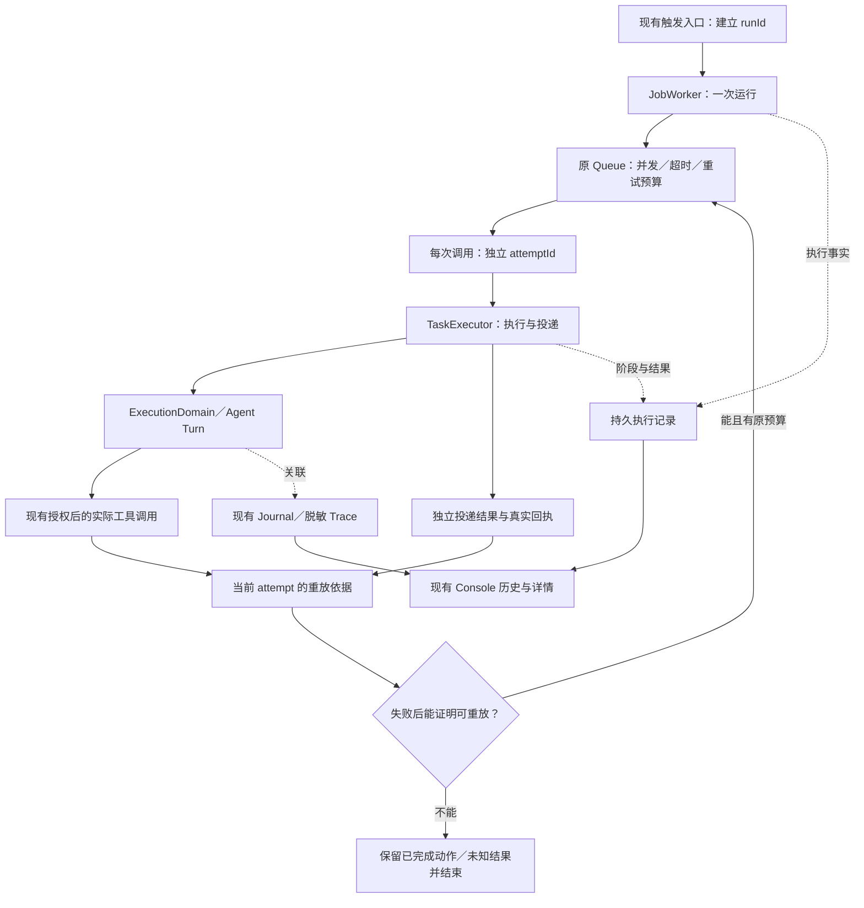

# 定时任务重放修复与执行记录方案

## 本轮目标与状态

1. 修复失败后从头重跑整个任务，导致已提交操作重复执行的问题。
2. 在 Console 查看每次执行的时间、过程和结果，而非只看任务的最后状态。

用户已确认采用本方案，并确认执行记录保留一个自然月、支持清理。本轮在独立工作树实施，不修改已提交的账号资料／提示词 PR、真实平台数据或用户配置。

沿用现有调度器、任务定义、权限审批、无人值守限制、并发、超时和重试次数。不增加自动续跑、补发、补偿、平台操作或通知渠道。

## 现状与根因

### 实际调用链

```text
JobEngine：计划触发／事件触发／现有手动触发
  → JobWorker
    → ScheduleExecutionQueue
      → TaskExecutor
        → ExecutionDomain → Agent Turn → 工具及可能的副作用
        → 终态 JSONL 审计
        → 最终结果投递
      → 失败结果被转换成普通 Error
    → 还有重试次数：再次调用整个 TaskExecutor
```

本地合成实验导入真实 JobWorker 和 Queue，仅替换 TaskExecutor：第一次增加模拟副作用计数后返回失败，第二次返回成功。在测试配置 `maxRetries:1` 和未修改的默认配置下均观察到调用两次。没有访问真实平台，不能把这个结果称为生产重复操作事故。

根因集中在三处：

- `JobWorker.run` 把 `success:false` 转为普通 Error，丢失此前已经执行的动作和原始结果；最终 catch 又生成一份零耗时、零工具、零用量的失败结果。
- Queue 对未取消的异常只检查剩余次数，不知道整个任务能否安全重放。任务执行成功后，最终通知失败同样落入这条重试路径。
- `ExecutionDomain` 的 `auditLogger.write`，以及 TaskExecutor 的 `activity.publish(start/error/finish)`，都可能在业务动作完成后抛错；活动反馈还可能覆盖原始异常。观测失败因此影响了业务重试。

模型请求重试、SDK 内部重试、模型再次调用工具、整个任务重放是不同层级。本次针对最后一层；不能用某个工具运行时只调用一次来证明整个任务不会重跑。

### 已有基础与缺口

| 现有能力 | 可以复用 | 需要补齐 |
| --- | --- | --- |
| JobStore（文件或 SQL） | 任务定义、最近执行摘要、现有存储装配 | 每次运行和内部尝试的独立历史 |
| Domain 的 executionId | 已等于 Agent turnId／traceId | 同次触发的 runId、尝试序号、重试原因 |
| 持久 Turn Journal | 实际工具过程、最终消息、终态完整性 | 运行归组、调度阶段及独立投递结算 |
| 持久 Trace／内存 Trace | 脱敏工具、模型请求、用量与时间线 | 精确关联调度尝试；过期或缺失时如实展示 |
| schedule-audit.jsonl | 旧终态审计 | 正式查询、完整结果、入队／开始／中断与投递记录 |
| Console `/cron`、`/assistant/jobs` | 任务入口与详情布局 | 按次执行列表、分页、具体尝试详情 |

当前 `lastExecutedAt` 在 Worker 返回后更新，不能当成真实开始时间。旧审计只保存输出长度，不保存最终结果正文；投递又发生在审计之后，不能据此推断消息已送达。

### 重启行为已核实

Queue 的待执行项、运行项及控制器都是实例内状态。`JobEngine.load` 只重新注册任务定义，不恢复旧 attempt；已过期的一次性任务不注册，周期任务按原调度方式重新计时。

因此本轮不为尚不存在的崩溃续跑引入逐操作写前日志、effects 表或分布式事务。重启后展示未结算记录为“中断／结果待核对”，不重发操作。新周期触发仍是新运行，不应混称恢复旧尝试。

## 模块分工



- **Queue** 继续只管排队、计时、并发、取消和重试调度，不解析工具名称、模型文本或数据库行。
- **执行链** 持有当前尝试的真实操作依据，将结构化结果／错误传给 Worker；Worker 不再用普通 Error 和空白结果覆盖已知事实。
- **执行记录模块** 保存运行／尝试摘要、脱敏基本过程和最终结果，供 Console 读取，不决定远端操作能否重发。
- **Host／Console** 做既有鉴权、分页和展示，不拥有调度状态机，不借查询触发执行。

状态属于当前运行及已捕获的账号操作，不放全局单例，不按同名账号寻找最新 Client。新增接口采用对象参数，复用现有注册与 generation 资源装配。

## 重放依据与失败处理

候选类型是内部执行合同，不是新的插件开关：

```ts
type ReplayEvidence =
  | { disposition: 'safe'; reason: 'read_only' | 'not_submitted' }
  | { disposition: 'committed'; operations: readonly OperationReference[] }
  | { disposition: 'unknown'; operations: readonly OperationReference[] };

interface ScheduleAttemptFailure {
  readonly cause: Error;
  readonly result?: TaskExecutionResult;
  readonly replay: ReplayEvidence;
}
```

实际调用前，在最终授权通过、即将进入工具执行时建立保守的尝试内记录。调用后按真实回执细化；后续异常不能抹掉已经确认或仍然未知的副作用。普通工具成功字符串不能证明其全部操作已提交。

复用正式 `ToolCapability.readOnly` 合同：它明确承诺不改变平台、存储或其他人。未声明不能按名称 `get_*`、风险等级低、无人值守 readonly 预设或模型描述推断为只读。子任务的动作必须汇入父尝试依据；无法证明的委派按未证实处理。

平台发送已有 `not_sent/rejected/unknown` 和部分回执；资料修改已有 `updated/rejected/unknown`。保留这些真实意义；通用工具和通知接口未提供的确定性不伪造。执行前权限拒绝证明尚未进入该操作；平台 rejected 则按操作／分段回执判断，不能覆盖已发送部分或此前动作。

```ts
// 同一次触发只创建一次 run；每次自动重试是独立 attempt。
const run = createRunContext(capturedTrigger);
// history.observe 独立处理记录错误，只报告缺口，不抛回业务链。
await history.observe({ phase: 'queued', run });

return queue.enqueueAndWait({
  ...existingQueueOptions,
  execute: async signal => {
    const attempt = beginAttempt({ run, signal });
    await history.observe({ phase: 'started', attempt });
    let outcome: AttemptOutcome;
    try {
      outcome = fromTaskResult(await executor.execute(job, { signal, attempt }));
    } catch (error) {
      outcome = fromExecutionError(error);
    }
    // 先固定真实业务结果；历史失败不能变成一次执行失败。
    const settled = settleAttempt({ outcome, replay: attempt.evidence() });
    await history.observe({ phase: 'finished', attempt, settled });
    return completeOrRaiseTypedFailure(settled);
  },
});

// 使用原次数和取消规则；记录写入失败本身不调用 executor。
if (!aborted && replay.disposition === 'safe' && retryBudgetRemains) retry();
else stopWithOriginalResult();
```

以上描述责任位置，不能照伪代码再造平行的通用执行框架。记录写入要走与任务结果分离的错误通道；不能仅包一层 catch 后丢失事实。

| 场景 | 建议行为 |
| --- | --- |
| 只执行已声明的只读操作，或所有副作用被证明未提交 | 允许原预算内重试，仍需通过原权限检查 |
| 动作已确认成功，随后模型／读取／格式处理失败 | 停止整任务重放，保留已完成动作和后续失败 |
| 动作可能已提交但超时／断连／回执不足 | 结果未知，停止整任务重放，不声称回滚或失败 |
| 后一次操作被拒绝，前面已有已提交／未知动作 | 不因拒绝而重新执行前面的动作 |
| Agent 结果已经生成，最终通知失败或未知 | 保留结果，单独显示投递状态，不重跑任务来重发通知 |
| JSONL、活动反馈、额外 Trace 或新增历史记录写入失败 | 保留业务结果及原始异常，报告记录缺口，不增加业务调用次数 |
| 现有强 Turn Journal 提交失败 | 保持原 Journal 完整性合同，同时保留调用前后的副作用依据，不能盲目重放 |
| 取消、超时、账号关闭后 SDK 返回晚到结果 | 逻辑取消不等于撤销远端效果；保留实际结果，不再启动新尝试 |

初版建议：实际进入了未声明只读、也没有可靠提交合同的工具后，不能证明整任务可安全重放，失败时停止自动从头重试。这会减少此类任务的自动重试，需要确认。

不增加剩余阶段自动续跑、仅重投通知、自动验证平台状态或补偿。真实 SDK 自行重试及不实的插件 readOnly 声明仍须分别审查，本方案不能替它们保证幂等。

## 执行记录的数据与存储

一次触发对应一条 **运行 run**；它内部每次执行对应一条 **尝试 attempt**。沿用 executionId 作为 attemptId，并贯穿 Domain、Turn 和投递；不再生成互相无关的标识。

| 记录 | 内容 |
| --- | --- |
| 运行 | runId、jobId、触发来源、计划时间（入口有提供时）、实际触发／入队时间、开始／结束时间、任务与完整账号／场景快照、运行结论 |
| 尝试 | attemptId、runId、序号、开始／结束时间、阶段、结构化错误、重试或停止原因、用量、最终输出、重放依据摘要 |
| 投递 | 未要求投递／未提交／已确认送达／部分送达／失败／未知；只保留接口能够证明的状态与逐条回执 |
| 基本过程 | 排队、开始、模型阶段、工具名称与脱敏结果状态、权限／审批结果、尝试结束、投递和运行结束 |
| 诊断引用 | 对应 journal／trace；缺失、截断或过期与业务结果分开显示 |

列表不加载正文、全部工具参数或模型请求。详情按需加载最终输出和阶段摘要；模型推理链、凭据、base64、私有图片字节及完整文件内容不作为执行过程保存。复用既有脱敏器并核验覆盖，不直接公开旧 JSONL。

存储沿用现有 SQL／文件模式，不因升级切换用户后端：SQL 经 CLI Database composition root 注册运行／尝试模型；文件模式在 data 下保存独立调度历史，复用现有文件原子提交和身份／序号约定。实现前固定文件查询与索引合同，不能每次打开页面扫描全部模型请求，也不能把新调度事件强塞进已终结的 AgentRunEvent 序列。

这是一份执行历史，不是逐副作用的持久事务账本。开始和结算都写入；追加阶段与结果按运行串行提交，重复结算按精确 ID 校验，不静默覆盖冲突。记录故障不得触发任务重跑。存储完全不可用时无法承诺历史完整，界面或读取错误应如实表达，不能伪造“没有执行”。

记录模块保留已经写成的摘要；重启后没有终态的旧记录展示为中断／待核对，不自动补造结束时间或外部成功状态。旧 audit 和 last* 只能作为旧来源，不能反推过去的完整尝试。

执行摘要、基本过程与最终结果保留一个自然月：以实际触发／入队时间为基准，UTC 日历回退一个月，月底钳制到上月最后一天，并保留时分秒。不以 30 天替代自然月。当前活动运行不清理；任务删除不级联删除历史，旧历史仍保留至同一期限。模型 Trace 继续使用其现有保留规则。

过期清理复用现有 generation housekeeping 的启动及发布后清理通道，不新增定时器、频率或通知。Console 的 full 管理清理只删除已过期且非活动的执行历史，不删除任务定义、Trace 或未到期记录；接口可重复调用，不触发任务重跑。需要删除未到期／全部历史时，另行确认具体范围。

## Console 页面和读取接口

实际页面位于独立仓库 `zhinjs/console`：`console-ui/src/pages/cron.tsx`、`assistant-jobs.tsx`；站点由 `client/host/ConsoleWebHost.tsx` 装配。monorepo 的 Console client 包只是 SDK，单改它不会让页面出现历史。

保留 `/cron` 为入口，在任务详情中增加“执行记录”。一次运行一行，选中后展开内部尝试；模型请求等诊断按需再展开，不把原始日志堆回配置表单。

```text
每日资讯
  11月02日 09:00    已完成 · 12秒 · 1次尝试
  11月01日 09:00    结果已生成 · 投递未知

选中一次运行
  09:00:00  入队
  09:00:01  开始尝试 1
  09:00:03  获取资讯：完成
  09:00:10  生成结果：完成
  09:00:12  通知投递：结果未知
  [最终结果] [过程详情]
```

示例时间和内容是界面结构示意，不是真实执行数据。不要在未知状态旁自动提供“失败重试”，也不新增恢复／重发按钮。

候选只读接口沿现有 `assistant.jobs` Console port 和 generation 解析：

```text
GET /api/assistant/executions?jobId=...&cursor=...&limit=...
GET /api/assistant/execution?jobId=...&runId=...
POST /api/assistant/executions/cleanup
```

列表采用稳定游标（时间加唯一 ID，不能只按 timestamp）；jobId 可省略以读取全局历史，任务已删除仍可从捕获的任务快照读取。详情包含 attempts 及精确 traceRef。复用 Trace 展示层；现有聊天 Trace hook 要求 IM conversation，不直接套给 schedule 会话。后台增量读取或刷新沿现有页面机制，不新增未确认的轮询频率。

当前在途运行的记录故障以 recordingIssue 标识；已结束运行的落盘失败释放正文，只保留常量大小的 recordingHealth（缺口计数、最后失败时间及运行引用），不建立无界的内存结果缓存或重试队列。列表显示记录缺口，缺失详情与从未存在的记录区分；不能因此伪装为“没有执行”。无终态的同进程旧 generation 记录显示“状态待核对”，不因热更宣称已中断，也不凭同进程就认定仍在执行。不同进程留下的未结算记录才显示“中断”，均不补造结束时间。

执行详情含任务内容和输出，沿现有敏感 Trace 的 `full` 鉴权，在后端检查；不只隐藏按钮。使用捕获的完整身份，检查 job/run/attempt 归属，切换 Host 后旧响应不得覆盖新页面。任务已删除的历史仍按精确记录读取，不回退同名账号。

本轮处理造成当前重放问题的 Agent 定时／事件任务及其实际预演路径。`/cron` 中另一类插件注册的普通 schedule 不经过 JobWorker，不把它伪装成本轮已经覆盖。无需实际执行的空 heartbeat 或无效触发不冒充一次已执行任务；扩展全部插件调度历史另列范围。

## 分工与交付顺序

1. **执行链 Agent**：固化旧实现红复现；贯通 attempt 的 typed evidence，保留真实结果和错误；分离投递及可选观测失败；Queue 仅添加安全重放判定，不改现有预算。
2. **记录与 Host Agent**：实现运行／尝试持久记录及两种现有存储模式，贯通身份，提供受权分页／详情；保留原任务状态入口，不新建调度器。
3. **Console Agent**：在独立 Console 仓库接入历史／详情，复用统一组件与 Trace 展示，补实际页面交互验证。
4. **主 Agent**：检查完整调用与取消／失败路径、权限、数据范围及记录故障；集成回归，核对实际构建页面，检查跨仓版本合同并提交可 review 的 PR。

架构和关键行为确认后开始上述开发。先验证实际副作用边界能提供什么证据，再定内部类型；不强行给所有插件套一个虚假的成功合同。

## 验收清单

每项记录“预期结果、实际证据、结论、未覆盖范围”。

- 旧实现真实 Worker＋Queue 在模拟副作用后失败会执行两次；新实现对 committed／unknown 只调用一次，对安全只读仍按原次数重试。
- 覆盖返回失败及抛错、写成功后读／模型／格式失败、后续拒绝、最终通知失败／未知、部分发送和无投递要求。
- JSONL、activity start/error/finish、历史落盘故障不导致业务重放，不遮蔽原错误；强 Journal 保持原合同。
- 入队取消、执行取消、timeout、忽略取消的 SDK、停止／热更、账号替换与晚到结果均保持身份和已知副作用。
- 同任务多次触发不串 run；同运行多次尝试有序，时间、用量、结果及投递状态可查，不被 last* 覆盖。
- SQL／文件存储可重启读取；无终态记录不自动执行；历史缺失、存储读取失败和不存在有明确区别。
- Console 覆盖 full 鉴权、归属校验、稳定分页、大历史量查询、切换 Host、Trace 过期、任务删除后读取；核验实际页面构建产物。
- 真实供应商／平台测试必须另获授权。本地计数和 mock 回执不等于真实平台幂等、生产送达或模型行为改善。

## 已确认的实施边界

1. 采用本方案：未分类的已调用工具不能证明可安全重放时，停止自动整任务重试；原预算、权限及调度不变。
2. 执行历史保留一个自然月，支持 full 管理清理已过期、非活动记录；任务删除不级联清理，Trace 的详细模型诊断仍沿其现有规则。

## 执行结果与既有 JobEngine 的对应关系

`TaskExecutionResult.success` 只代表本次业务执行是否按现有输出校验／预算规则完成，最终投递另存 `delivery`。取消保留 `cancelled`；既有预算规则接受的部分输出保留 `success:true`，但状态明确为 `budget_partial`。这些状态不等于平台操作已回滚，也不扩大原有预算或重新调用模型。

- `lastStatus`／`lastError` 继续由业务 `success` 更新，不能把通知投递失败覆盖为业务失败；`lastExecutedAt` 仍是旧摘要的完成更新时间，准确入队／开始时间从独立历史读取。
- `notifyOnFailure` 继续只响应业务失败，不因最终通知失败再发一份“任务失败”通知。本轮不增加新的通知渠道或自动重投。
- 一次性任务的 `deleteAfterRun` 继续以业务成功为条件；结果已经生成但通知失败／未知时，也不会为了保留定义而重跑任务。删除定义不删除独立执行历史，已完成内容和逐条投递依据仍可查看。
- 每次实际触发生成一个 `runId`，同一次安全重试生成新的 `attemptId`（即 Domain `executionId`／Turn `turnId`／Trace `traceId`），原失败的用量、输出和过程不被下一次尝试抹掉。
- `tool_call` 在授权前发出，只是请求过程，不作为已进入工具或已提交的证据。真正调用入口采集正式 `readOnly` 声明；未分类调用保持 `unknown`，原生动作 owner 在真实写入／正式回执之后才报告 `committed`，不会解析普通工具字符串猜成功。
- Queue 的重试决定来自实际剩余次数、取消状态及执行方的重放依据，并单独记录 `attempt_replay` 原因；历史模块不参与重放准入。

以上为当前实现与已确认规则的对齐说明；存储始终挂起时的资源／关闭边界仍按下节候选方案单独确认，不能将尚未完成的观察通道称为通过验收。

## 待确认：存储缓慢时的有界写入

持久化可能缓慢或始终不返回；不能让记录 I/O 阻塞任务并触发业务超时，也不能把每个事件／终态正文无限排进内存。候选规则如下，确认后才实现：

- 历史模块独占一个物理写入；同一运行的变化合并为当前快照，不排无界的事件或 Promise 队列。
- 已结束、尚未落盘的运行最多保留 128 份，且其投影脱敏后序列化 JSON 的 UTF-8 总大小最多 16 MiB；任一达到上限便不再保留新终态正文，只增加常量大小的 recordingHealth 缺口摘要。任务继续、不因记录不足重放；空位恢复后正常收录后续运行。
- 正在执行的运行仍由既有 owner／并发规则管理，不新增业务排队或记录轮询。未确认新重试次数、定时器或通知。
- 当前最终输出和任务 prompt 没有这一级字节上限；单份快照也可能超过 16 MiB。不能为了塞进队列擅自截断最终结果、缩小模型预算或改变任务行为；不能完整保留时明确呈现缺口。
- 关闭时停止接收记录、释放尚未提交的正文，不无限等待无法取消的底层 I/O。已经提交的 SQL／文件写入是否可取消，须按现有驱动和 Host 停止预算区分，不能承诺物理写一定已经终止。

这项容量／满载取舍仍待用户确认；当前存储与只读 API 的实现不等于该异步通道已经完成或验收。

记录属于可观测历史，失败不得控制业务执行或触发重跑；不引入逐副作用强制落盘、重启自动续跑或新通知策略。若需要“存储不可用就禁止任务执行”的强审计准入，须作为另一项行为变更明确设计和确认。
