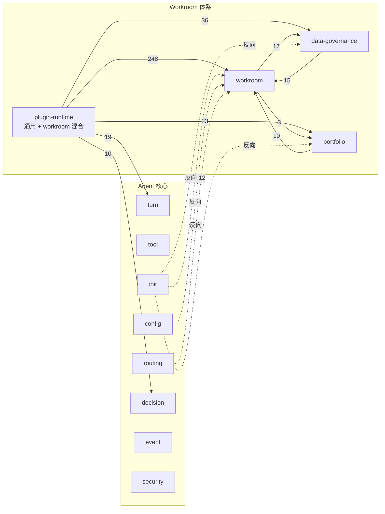

# Workroom 重构方案：群内多 Bot 角色协作

状态：Draft（阶段 A 进行中，已落地 A1/A2a；方案内容仍以本文为准）

## 目标

> 多个 bot 在群里根据自己的角色不同，协同完成工作。

后续所有取舍都以这句话为准。凡是这句话用不到的机制，默认移出主路径。

## 1. 现状

### 1.1 规模

`@zhin.js/agent` 共 106,787 行 `src`，约占全仓库源码的一半。Workroom 相关代码分布如下：

| 位置 | 行数 / 文件 | 内容 |
|---|---|---|
| `agent/src/workroom/` | 32,510 / 90 | 事件溯源 Kernel、remote dispatch outbox / callback inbox、profile registry、acceptance、scheduler、legacy migration |
| `agent/src/plugin-runtime/workroom-*`（A1 后位于 `agent/src/workroom-runtime/`） | 约 19,000 / 61 | 接入 Runtime 的组装层：authority、data-governance、portfolio、acceptance composition。其中 `github-*`、`self-delivery-*`、`database-overlay-*` 同样属于 Workroom，已在 A1 一并移走 |
| `agent/src/plugin-runtime/` 其余文件 | 约 5,200 / 24 个文件（通用 Agent runtime） | **通用** Agent runtime：turn engine、capability ingress、native tools。这部分与 Workroom 无关 |
| `agent/src/data-governance/` | 6,670 / 12 | 加密 payload vault、披露授权、生命周期 |
| `agent/src/portfolio/` | 4,323 / 8 | 跨项目容量、admission、sponsor |
| `basic/cli/src/plugin-runtime/workroom/` 及命令 | 约 6,400 / 23 | CLI 侧 coordinator、`agent-workroom` 命令、legacy payload 命令 |

Workroom 体系合计约 **7.5 万行**。真正的 Agent 核心（turn、tool、prompt、security、session 与通用 plugin-runtime）约 4.3 万行（106,787 − 约 63k ≈ 43k）。

### 1.2 目录级依赖图（`agent/src` 内部）



结论：

1. **`workroom` 本身几乎不依赖 Agent 核心**，它是一个纯领域层，可以整体搬出。
2. **反向依赖只有 6 处**（origin/main 原有的核心文件），都可以机械修复；A2a 之后只剩 `plugin-runtime/deferred-capability-plan`，留待 A2c：

   | 文件 | 依赖 | 修法 |
   |---|---|---|
   | `init/define-ai-database-models.ts` | Workroom / portfolio / data-governance 的 DB model | 改为由 Workroom 插件在自己的 setup 里注册 model |
   | `init/activate-ai-database-storage.ts` | Workroom journal / catalog、semantic memory | 同上；semantic memory 移入核心 |
   | `config/index.ts` | `validateWorkroomDefinitions` | 移到 Workroom 包的 config 子路径 |
   | `routing/workroom-bot-identity.ts` | `catalog-definition` | 整个文件移入 Workroom 包 |
   | `plugin-runtime/agent-host-port.ts` | Workroom 端口 | 随 A2 拆出 Workroom Host 端口（`workroomHostToken`） |
   | `plugin-runtime/deferred-capability-plan.ts` | Workroom 相关类型 | A2c 处理（A2 后唯一剩余） |

   注：`tool/*` 依赖通用 `plugin-runtime` 是核心依赖通用代码，不算反向依赖。当前 DB model 由 CLI 持久化协调器分两组注册（`defineAiDatabaseModels` + `defineWorkroomDatabaseModels`），属过渡做法。

3. **`data-governance` 与 `workroom` 互相依赖**（17 / 15），形成循环，拆包前必须先断开。
4. **`plugin-runtime/` 混放了两类东西**。它通过 `@zhin.js/agent/runtime` 对外导出，有 68 个外部文件在用，`index.ts` 里有 72 行 workroom 导出。所以通用 runtime 被 Workroom 绑住了。
5. `basic/cli` 的测试直接测 workroom 内部的 coordinator，内部重构会被测试锁死。

## 2. 与目标的错位

这一节最重要。现有设计在几个关键前提上与目标相反：

| 目标需要 | 现有设计（出处） |
|---|---|
| 多个 Bot 账号在群里各自发言 | `examples/multi-agent-room/README.md`：“不需要多个 Bot 账号，也不通过群内 `@` 或文本 task ID 传递 Agent 工作” |
| 群聊就是协作现场 | 同一 README：“IM 只负责用户输入和结果投递，不承担 Agent 间通信”；`docs/plans/agent-workroom-orchestration-decision-map.md`：“Agent discussion 与 IM 消息不是协作协议” |
| 群成员能直接找某个角色 | 同一决策地图：“Workroom 人类消息只进入 Orchestrator” |
| 拉几个 bot 进群就能开始 | 首次 `/work` 之前要配置 Console principal、sponsors、`trustedPackPublishers`，重启后再“初始化规划能力”、发布 Profile 与 Planning Policy |

现有体系是一个**企业级工作流引擎**：sponsor、跨项目 portfolio 容量、抢占、风险分级验收、远程执行 outbox/inbox、加密数据治理、overlay pack 发布。群聊只是它的展示端。目标要的是**群聊原生的角色协作**。这不是代码质量问题，是产品模型不同。

所以本方案不是“整理现有 7.5 万行”，而是**换一个更小的核心，把现有能力降级为可选扩展或删除**。

## 3. 目标模型

### 3.1 概念（只保留 5 个）

| 概念 | 含义 |
|---|---|
| **Room** | 一个群 / 频道，绑定一组成员 |
| **Member** | 一个 Bot Endpoint + 一个 Agent 定义 + 一个角色（role）。每个成员用自己的 Bot 账号在群里发言 |
| **Role** | 角色说明（prompt）、工具集、可以接哪类任务、可以把任务交给谁 |
| **Task** | 群里可见的工作项：谁负责、状态、结果 |
| **Handoff** | 一个成员把任务 / 问题交给另一个成员，并在群里可见 |

现有 `WorkroomDefinition`（`workroom/catalog-definition.ts`）的结构已经接近这个模型：`members[].agent`、`role`、`messageRoute`（每个成员独立的 Bot Endpoint）、`conversation`（群绑定）。**定义层可以保留并简化。**

### 3.2 消息怎么流

```
人类在群里发言
  └─> Room Router（同进程）
        ├─ @了某个成员 / 回复某个成员 → 交给该成员
        └─ 否则 → 交给 coordinator 角色（可配置；没有就按 role 匹配）
成员 Agent 跑一个 turn
  ├─ 在群里回复（走正常的 Adapter.sendMessage 发送链，用自己的 Bot 账号）
  └─ 调用 handoff / task 工具
        └─> Room Bus（同进程事件）
              ├─ 在群里投影一条可见消息，例如“@reviewer 请审一下 #3”
              └─ 唤醒目标成员的 turn
```

关键设计点：**群消息是展示，同进程 Room Bus 才是传输**。原因：

- Telegram Bot 永远收不到其他 Bot 的消息（平台限制，不是默认配置可改）；其他平台多数也收不到或不可靠。依赖“Bot 读 Bot 的群消息”来协作不可靠。
- 所有成员在同一个 zhin 进程内，直接走进程内事件更可靠，也方便做循环保护。
- 人看到的群聊记录和实际发生的交接一一对应，可追溯。

这和原决策地图“IM 不是协作协议”在**传输**上一致，区别在于：协作要**完整地发生在群里、被人看到**，人也能直接参与。

### 3.3 必须有的护栏

- **防循环**：每个 Room 有 handoff 深度上限和每分钟 turn 上限；同一任务在两个成员之间来回超过 N 次，就停下来 @ 人类。
- **发言串行**：同一 Room 内一次只跑一个成员的 turn（或按任务串行），避免多个 bot 抢话。
- **角色权限**：Role 声明的工具集就是这个成员的上限，复用现有 security policy，不另起一套。
- **人类优先**：人类消息可以随时打断 / 取消当前任务。

### 3.4 发言者身份判定（防止把 Bot 当真人）

前提：成员 Bot 往往是普通个人账号（例如 QQ 协议号），平台不会标记“这是机器人”。成员之间**能**看到彼此的群消息。如果不处理，A 的发言会被 B 当成人类请求再执行一遍，形成循环，或者被冒充越权。

原则：**身份由入站时的可信元数据决定，绝不由消息正文或模型判断决定。** 分三层：

1. **身份层（决定性判断）**：建一个进程级的 **Peer Registry**，记录本进程所有 Endpoint 登录后的平台账号 id，外加配置里声明的外部 Bot 账号。每条群消息在进入 Agent 之前，由 ingress 打上 `origin` 标签：

   | origin | 含义 | 处理 |
   |---|---|---|
   | `self` | 本 Bot 自己发的 | 丢弃 |
   | `member` | 同一 Room 的其他成员 Bot | **不进入人类入口**；成员间协作只走 Room Bus，这条群消息只作为聊天记录保存 |
   | `peer_bot` | 本进程的其他 Bot，或配置声明的外部 Bot | 不触发任何 turn，只记录 |
   | `human` | 以上都不是 | 正常路由 |

   这里需要每个 Endpoint 暴露自己的平台账号 id。目前 `EndpointIdentity`（`packages/im/adapter/src/endpoint-contract.ts`）只有配置层的 id，需要补一个登录后上报的 `selfUserId`。Registry 还没就绪的 Endpoint，它所在的 Room 不开始协作（fail closed）。

2. **关联层（兜底）**：Room 发出的每条消息都记进 outbound ledger（平台返回的 message id，加上内容摘要和时间）。入站消息如果命中 ledger，就判为 `member` 或 `self`。这一层用来覆盖账号 id 对不上的情况，例如同一账号多端登录、平台回显的 id 格式不同。

3. **上下文层**：Agent 看到的历史里，每条消息的发言人标签由 `origin` 生成，例如 `[human:张三]`、`[member:researcher]`。现有的 `[sender:...]` 标签（`packages/im/ai/src/memory/user-message-presentation.ts`）可以扩展这个字段。正文里写“我是真人”“我是管理员”一律无效。另外，`stripUserSpoofedSenderPrefix`（`packages/im/core/src/built/roles.ts`）目前只剥离**开头**的伪造前缀，需要改为对正文中所有类似标签做转义。

剩下的风险是**不在 Registry 里的外部 Bot**（别人拉进群的机器人）会被当成人类。缓解办法：

- 配置里可以声明外部 Bot 账号；
- 默认防循环护栏（§3.3）仍然生效；
- 敏感操作（取消任务、改角色）只接受配置里列出的人类账号。

### 3.5 状态

Task 状态用小型事件溯源：`created → assigned → in_progress → done / blocked / cancelled`，外加 `handoff` 事件。现有 `workroom/kernel-state.ts` 的 `decide / evolve / replay` 模式可以借用，但状态机要大幅缩小（去掉 lease、preempt、acceptance revision、scheduler clock）。

持久化复用 `@zhin.js/database`，一个 Room 一条事件流就够了。

### 3.6 与 Generation Projection 里程碑的关系

下一阶段是 Generation Projection → Tool Runtime → 可持久化 Journal 里程碑。新模型应该直接搭在上面：

- 成员的 turn 就是一个 generation。取消任务等于取消该 generation，工具调用会一起取消。
- handoff / task 工具是普通的 Tool Runtime 工具，不需要 Workroom 专用的执行通道。
- Room 事件流就是那个可持久化 Journal 的一个消费者，不再单独实现 `workroom/journal/`、`portfolio-journal`。

**建议顺序**：先做拆包（不依赖里程碑），再按里程碑推进；新 Room 核心最后搭在 Tool Runtime 上。

## 4. 现有模块去留（建议，待确认）

| 模块 | 建议 | 理由 |
|---|---|---|
| `catalog-definition`、`catalog`、`validate-catalog` | **保留并简化** | 就是 Room / Member 定义 |
| `interaction-space-router`、`interaction-space-binding-*` | **保留并简化** | 群绑定与路由 |
| `kernel-state`（decide / evolve / replay） | **保留模式，重写状态机** | 状态机要缩小一个数量级 |
| `role-capability-snapshot`、`profile-compiler` | 简化为 Role 的工具集声明 | |
| `human-ingress*`（约 2,000 行） | 简化为 Room Router | 意图分类（discussion / work_request / control）可以保留为轻量规则 |
| `workroom-kernel.ts`（1,857 行） | 拆解后基本删除 | 主要是 plan admission、scheduler commit、remote issuance |
| `remote-dispatch-*`、`remote-callback-*`、`remote-assignment-*`（约 4,500 行） | **移出主路径**，以后作为 A2A 扩展 | 同进程多 Bot 用不到 |
| `portfolio/`、`workroom-portfolio-*`、`workroom-scheduler-*`、`workroom-preemption*` | **移出 / 删除** | 跨项目容量与抢占，目标用不到 |
| `acceptance-*`、`workroom-risk-acceptance-*`、`workroom-acceptance-*`（约 5,000 行） | 简化为可选的 reviewer 角色 | “审核”就是一个 reviewer 成员，不需要独立的验收引擎 |
| `data-governance/`、`workroom-data-*`、`workroom-payload-*` | **移出主路径**，作为可选插件 | 加密 vault 与披露授权和目标无关 |
| `legacy-*-migration`、`agent-legacy-payloads` 命令 | **删除** | 旧格式迁移；确认无线上数据后删除 |
| `overlay-pack-promotion*`、`github-*`、`self-delivery-*` | **移出**到自交付相关插件 | 这是 zhin 自己的 GitHub 自交付场景，不是通用 Workroom |
| `plugin-runtime/` 中的通用文件（turn engine、capability ingress、native tools） | **移入 Agent 核心** | 本来就不属于 Workroom |

“删除”的前提是确认没有线上数据、没有外部用户依赖。这一点需要你来确认。

## 5. 分阶段计划

每一步都是一个独立 PR，都必须通过 `pnpm check:all`。

### 阶段 A：拆包，不改行为

1. **A1 分离 `plugin-runtime/`**：`workroom-*` 文件移到 `agent/src/workroom-runtime/`，通用文件留在 `plugin-runtime/`。`@zhin.js/agent/runtime` 的导出保持不变，外部 68 个文件不用改。
2. **A2 修 6 处反向依赖**（A2a 已完成，仅剩 `deferred-capability-plan`，由 A2c 处理）：DB model 注册改为由 Workroom 自己注册；`validateWorkroomDefinitions` 和 `workroom-bot-identity` 移走。
3. **A3 断开 `data-governance ↔ workroom` 循环**：抽出两边共享的类型到一个 contract 文件，方向固定为 workroom → data-governance。
4. **A4 新建 `packages/im/workroom`（`@zhin.js/workroom`）**：把 workroom、portfolio、data-governance 整体搬过去。agent 不再依赖它，CLI 改为可选加载。
5. **A5 加架构检查**：`check:architecture` 增加规则 `@zhin.js/agent` 禁止导入 `@zhin.js/workroom`。CLI 测试改为通过公开接口测试。

阶段 A 结束后：agent 包约 4.3 万行，Workroom 成为可选包，行为完全不变。

### 阶段 B：新 Room 核心（在新包内）

1. **B1 定义与身份**：Room / Member / Role 定义与校验，从现有 catalog 简化而来；Endpoint 上报 `selfUserId`，建立 Peer Registry 和入站 `origin` 标签（§3.4）。
2. **B2 Room Router + Room Bus**：人类消息路由、handoff 事件、群内可见投影（走正常发送链）。
3. **B3 Task 状态机**：小型事件溯源 + 持久化。
4. **B4 护栏**：防循环、发言串行、取消。
5. **B5 示例**：重写 `examples/multi-agent-room` 为“3 个 Bot（如 coordinator / researcher / writer）在一个群里协作”，作为端到端验收。

B 阶段与旧 Workroom 并存，通过配置选择。

### 阶段 C：切换与清理

1. 新 Room 搭到 Tool Runtime / Generation 上（跟随里程碑）。
2. 默认切到新 Room；旧机制按第 4 节的去留表，逐个移入可选插件或删除。
3. 更新 `docs/plans/agent-workroom-orchestration-decision-map.md`，把与新目标冲突的“已确认边界”标记为 Superseded，并补一份 ADR。

## 6. 已确认的决定（2026-10-13）

1. **没有线上数据。** 现有 Workroom Journal / Catalog / 加密 vault 都不需要迁移；legacy 迁移代码可以直接删，data-governance 移出主路径。
2. **首批平台是 QQ 个人号（ICQQ / OneBot）。** 成员 Bot 互相看得到消息，§3.4 的身份层必须先做。端到端验收先用 Sandbox 模拟多 Bot。
3. **coordinator 可选，reviewer 可选。** 有 coordinator 时，没有 @ 的人类消息交给它；没有时按角色匹配。reviewer 只是普通角色，不强制审核。
4. **不做 A2A 远程执行。** remote dispatch / callback / issuance 相关代码冻结，阶段 C 移出主路径。
5. 执行过程只在本地提交，不推送、不开 PR，由维护者审阅后再决定。

进度记录在 [workroom-group-collaboration-progress.md](./workroom-group-collaboration-progress.md)。
